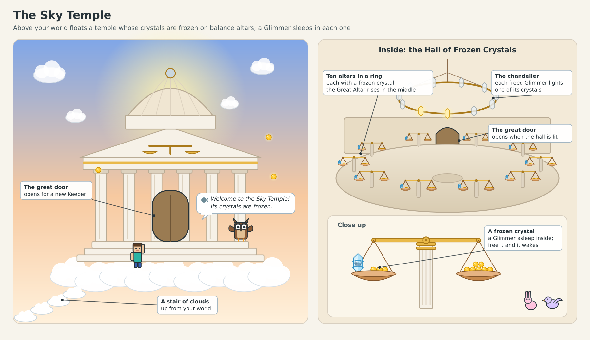
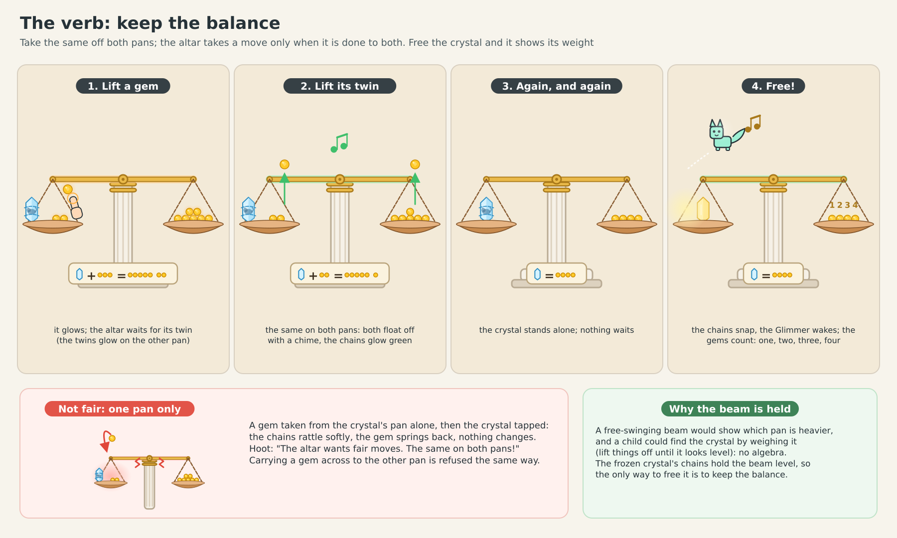
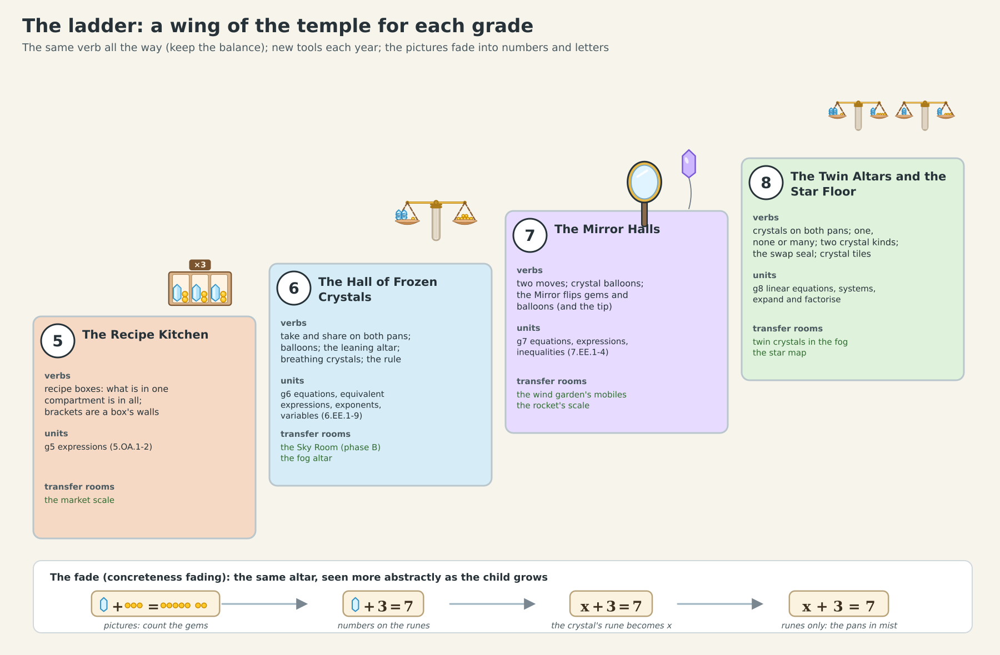

# Balance Altar: the second "future lesson", on one page

**The idea.** Above your child's world floats a temple of light. Its crystals are frozen on great golden scales, and
inside each crystal a tiny crystal creature, a Glimmer, is asleep. Your child is the temple's new Keeper. The temple lets
a crystal go only one way: when the scale is kept balanced. Free a crystal and its Glimmer wakes, sings one note and
flies up to light the hall; free a whole hall and all the Glimmers sing together and a great door opens onto the next
room. Nothing to read: Professor Hoot says one short line at a time, and everything else is seen, heard and done.

**What your child does in the first ten minutes**
- Each scale holds a frozen crystal and a few gems on one side, and gems on the other side. Both sides weigh the same.
- Hoot's ghost hands show the one move the temple accepts: take a gem off *both* sides. Your child does the rest. When
  the crystal stands alone, it cracks open and the gems on the other side count themselves: "Free! It weighs four gems!"
- Taking from one side only, or moving a gem across, doesn't work: the chains rattle softly, the gem springs back and
  nothing changes. Your child finds the rule by trying.
- Next, two crystals weigh six gems: share both sides into two bowls, and one crystal weighs three. Then the Great Altar
  needs both moves, in the right order, and the whole hall sings.
- Then the Sky Room, where balloons pull the scales up. The old trick ("take it away") doesn't work there; your child has
  to discover that a gem cancels a balloon, and put gems on both sides.

**What your child learns, without reading a word**
- **Solving an equation**: keep both sides equal by doing the same to both. In one study of 177 middle-school students,
  not one of the 47 sixth graders used this method on paper; they guessed or worked backwards, which stops working as
  soon as the unknown appears on both sides.
- **What "=" means**: "the same as", not "the answer comes next" (about two in three sixth graders get this wrong).
- **That a letter stands for a number**: the crystal's weight. The pictures slowly turn into numbers and then into "x" as
  your child grows, and Hoot reads every equation aloud, so the symbols are heard before they are read.

**Guessing doesn't work.** We tested it with a computer model of the temple, 1,000 visits for each kind of player. A
child who knows the rule earns the hall's star every time (95 % of the time even with careless slips). Random tapping,
guessing which move to make, working on one side only, or using half the rule almost never does: at most 2 visits in
1,000. In the Sky Room, the old habit fails every time and the real rule wins every time.

**It grows with your child.** Every school year a new wing of the temple opens: recipe boxes (brackets) at grade 5; the
frozen crystals, the Sky Room, see-saws that stay tipped (inequalities) and crystals that breathe (letters that can be
any number) at grade 6; the Mirror Halls (negative numbers) at grade 7; twin altars (two unknowns at once) and crystal
tiles (multiplying brackets) at grade 8. Together they cover eleven of our maths units.

**In VR** your child lifts a gem off each side with their two hands at the same time: a two-handed gesture that, in a
study of 84 children, helped this kind of learning last (85 % of what was learned kept a month later, against 33 %
without it).

**What happens next.** The lead reviews this design. Then the first two rooms (the Entrance Hall and the Sky Room) are
built, complete and beautiful, on phones, the web and the Quest: about six agent sessions. Your child plays them first,
and we watch whether they choose to come back.

The full design: `balance-altar.md`.
