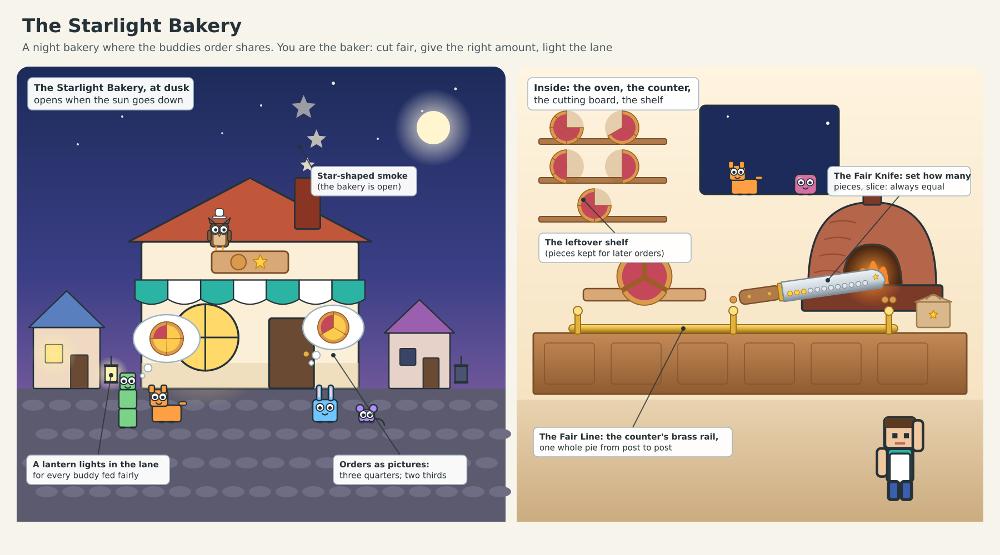
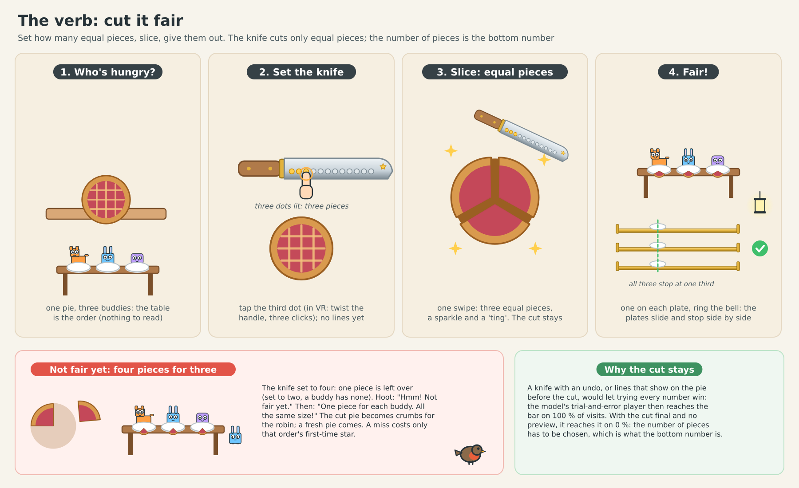
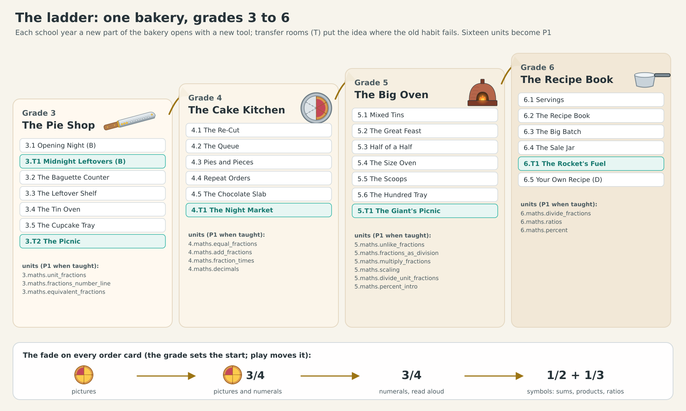

# Fraction Bakery: the third "future lesson", on one page

**The idea.** At the edge of your child's world stands a little bakery that opens when the sun goes down. Your child is the
night baker. The village's buddies (EasyCraft's block creatures with googly eyes) come to the window hungry: a table of
five buddies with two pies to share, or one buddy with a takeaway box and a picture of what it wants. Every buddy fed
fairly hops with joy and the lantern in its cottage lights up, until the whole lane glows and everyone sits down to a
feast under the stars. Nothing to read: Professor Hoot says one short line at a time, and everything else is seen, heard
and done.

**What your child does in the first ten minutes**
- Four buddies, one pie. Hoot's ghost hand sets the magic knife to four and slices: the pie falls into four equal pieces.
  Your child gives one piece to each buddy. The plates slide along the counter's brass rail and stop side by side:
  fair. A lantern lights.
- Three buddies, one pie. If your child cuts it in two or in four (the easy way), a piece is left over or a buddy goes
  without: not fair yet. A little robin eats the crumbs, a fresh pie comes, and your child finds that three buddies need
  three pieces.
- A buddy wants three quarters of a pie. Cut it into four, three pieces in the box, push the box along the rail: it ticks
  along and stops exactly where the buddy's flag pops up. A box with too little stops short, and the gap shows how much
  is missing.
- At midnight the oven sleeps and only leftover pieces remain, already cut in eighths. The old trick ("three quarters
  means three pieces") stops short; your child discovers that six eighths are the same as three quarters.

**What your child learns, without reading a word**
- **What a fraction is**: the bottom number is how many equal pieces the whole is cut into, the top number is how many you
  take, and the size of the pieces is what counts. This is the topic children fail most: in one study, sixth graders got
  only about seven in ten simple fraction comparisons right, and children often say an eighth is bigger than a sixth
  "because eight is bigger than six".
- **Fractions as sharing** (two pies for five buddies is two fifths each) and **fractions as numbers on a line**: every
  order slides along the brass rail and stops at its amount, the picture researchers have found matters most.
- Why it matters: children's knowledge of fractions at age 10 predicts their algebra and maths years later, in large
  studies in the US and the UK.

**Guessing doesn't work.** We tested it with a computer model of the bakery, 1,000 visits for each kind of player. A child
who knows what a fraction is earns the night's star every time (88 % of the time even with careless slips). Random
cutting, trial and error, only ever halving, or cutting everything tiny and dealing it out almost never does: at most 26
visits in 1,000, and only because that last player already reads the boxes right. At midnight, the old trick fails every
time and real understanding wins every time.

**It grows with your child.** Every school year a new part of the bakery opens: the Pie Shop at grade 3 (sharing, a fraction
of a whole, equal fractions, adding pieces of the same size), the Cake Kitchen at grade 4 (comparing any two, mixed numbers,
tenths and hundredths on a chocolate slab), the Big Oven at grade 5 (adding different-sized pieces, a magic oven that
shrinks and grows cakes for multiplying, measuring scoops for dividing, percents) and the Recipe Book at grade 6 (dividing
fractions, recipes as ratios, percents of a jar). Together they cover sixteen of our maths units.

**In VR** your child takes the knife in their hand, twists the handle until the right number of lights glow (a click for
each), slices through the pie, carries each piece to a plate, and shoves the box along the counter.

**What happens next.** The lead reviews this design. Then the first two rooms (Opening Night and Midnight Leftovers) are
built, complete and beautiful, on phones, the web and the Quest: about six agent sessions. Your child plays them first, and
we watch whether they choose to come back.

The full design: `fraction-bakery.md`.
