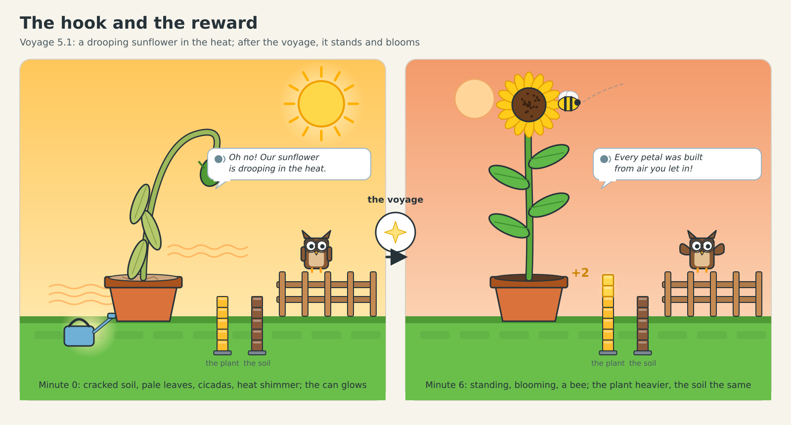
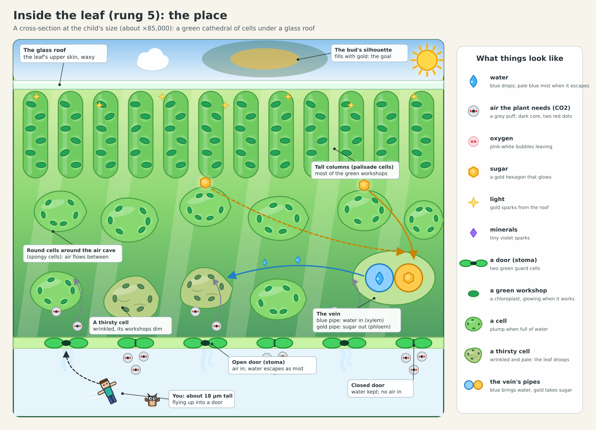
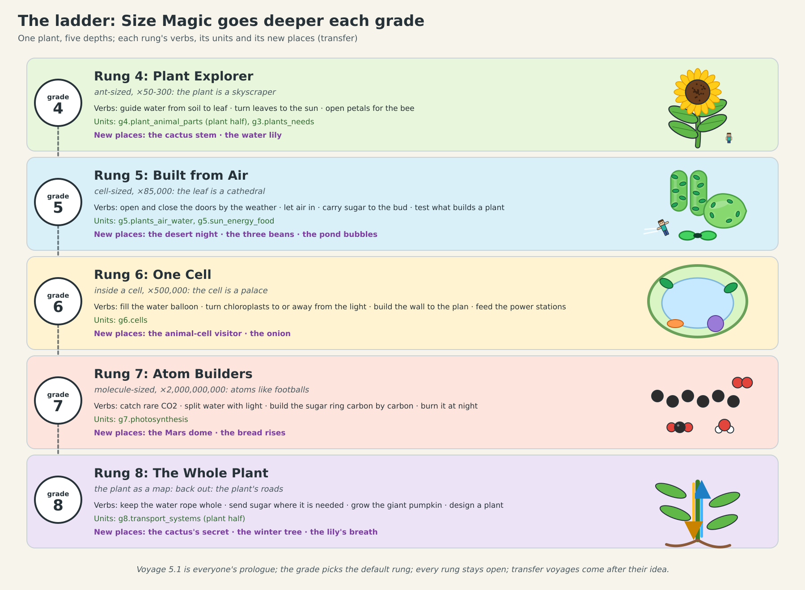

# Inside a Leaf: the first "future lesson", on one page

**The idea.** Your child's sunflower is drooping in the heat. EasyCraft's Size Magic shrinks them smaller than a hair, and
they fly up through one of the leaf's tiny doors into a giant green world of cells, with sunlight pouring through the
roof. They find out why the plant droops and fix it with their own hands. When they grow back, the sunflower stands up
and its flower opens, and a bee lands on it. Nothing to read: Professor Hoot says one short line at a time, and
everything else is seen, heard and done.

**What your child does in the first ten minutes**
- Waters the drooping sunflower. It still droops. Touches a leaf, and the garden grows enormous around them.
- Inside, blue mist is pouring out of the leaf's open doors: the plant is losing its water. Hoot shows how to squeeze one
  door shut; your child shuts the rest, the cells fill up, and the whole leaf lifts.
- But now no air can get in, and the leaf's green workshops stop. When a cloud cools the sun, your child opens the doors:
  air drifts in, the workshops light up and build gold sugar. When the sun blazes again, they close the doors and carry
  the sugar to the pipe that takes it to the flower.
- The flower bud fills with gold. Back in the garden, it opens.

**What your child learns, without reading a word**
- A plant is built mostly **from air and water, not from the soil**: Hoot says it at the end ("Every petal was built
  from air you let in!"), and two little block scales by the pot show the plant got heavier while the soil did not. This
  is the most common mistake people make about plants, adults included.
- Leaves take in air through tiny doors, and the same doors let water escape: real plants open and close them to
  balance the two, as your child just did.
- Light gives the energy; sugar is the plant's own food, which it makes itself.

**Guessing doesn't work.** We tested it with a computer model of the leaf: a child who opens and closes doors at random,
or leaves them all open, or all shut, never reaches the stars. Only understanding the weather and the doors wins, every
time.

**It grows with your child.** Every school year Size Magic takes them one level deeper: the plant's parts (grade 4),
inside the leaf (5), inside a single cell (6), the atoms themselves (7), then back out to run the whole plant (8). On
the way there are new places where the old habit fails and real understanding wins: a cactus in the desert that can only
open its doors at night, a water lily with its doors on top, a tree living through winter, a garden under a dome on
Mars.

**In VR** your child moves through the leaf by pulling themselves along with their arms, the way they move in Gorilla Tag,
and closes each door by squeezing its two halves together.

**What happens next.** The lead reviews this design. Then the first two voyages (the drooping sunflower and the desert
night) are built, complete and beautiful, on phones, the web and the Quest: about six agent sessions. Your child plays
them first, and we watch whether they choose to play again.

The full design: `leaf-voyage.md`.
