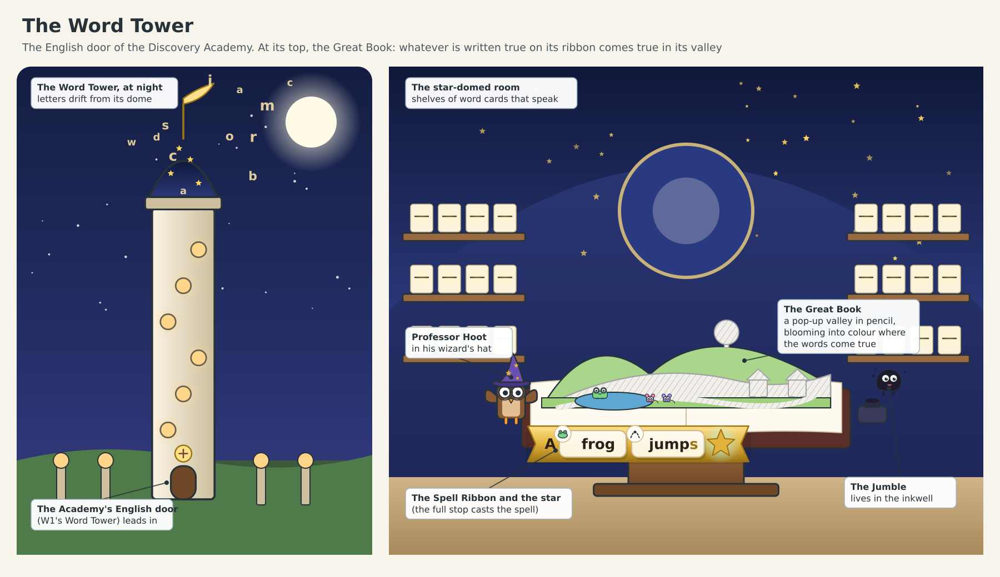
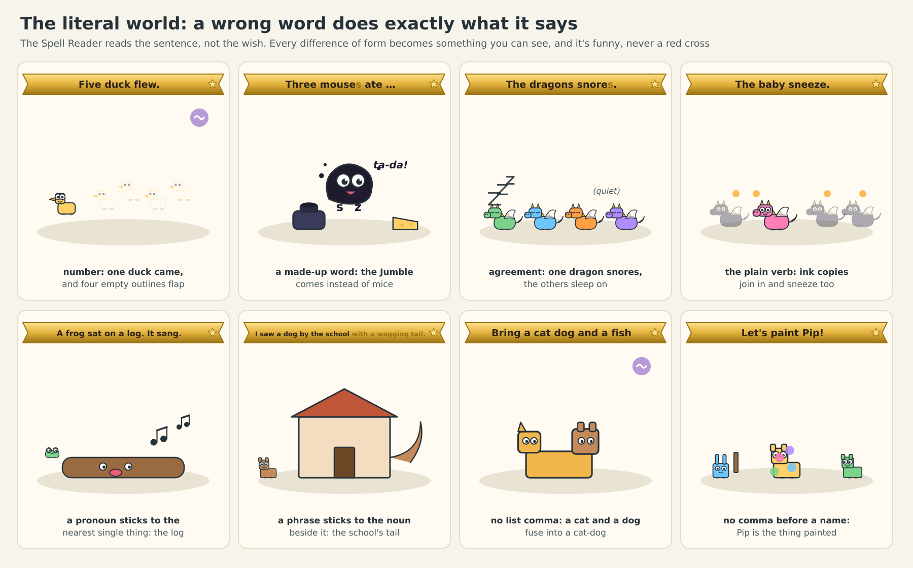
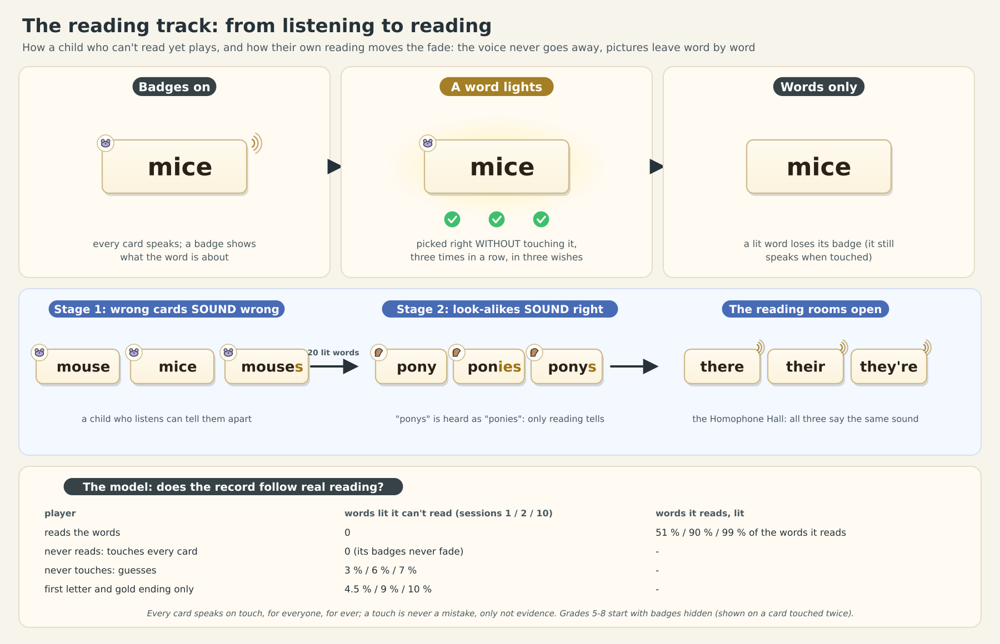

# Word Magic: the fourth "future lesson", on one page

**The idea.** At the Discovery Academy stands the Word Tower. At its top lies a giant magic book, open on a lectern,
and its pages fold up into a little valley drawn in pencil: hills, a pond, cottages, all grey and empty. The book has
one rule: **whatever your child writes on its golden ribbon comes true in the valley.** The valley's buddies come with
wishes, shown as pictures in thought bubbles (three hungry mice and a cheese). Your child picks word cards off the
tower's shelves, lays them on the ribbon ("three", "mice"), touches the gold star at the end (the full stop), and the
words fly into the page as ink: three mice appear, nibbling the cheese, and that corner of the valley turns from pencil
into colour. By the end of the night the whole valley is in colour and everything your child wrote marches past in a
parade.

**The trick that makes it teach.** The world does exactly what the sentence says, not what your child meant. So
grammar is what happens. Write "five duck" and one duck flies up beside four empty outlines. Write "mouses" (a made-up
word the cheeky ink blob, the Jumble, slips among the cards) and the Jumble pops out of the inkwell instead of mice,
giggling. Write "the dragons snores" and only one dragon snores while the others sleep on. It is funny, never a red
cross, and your child sees why the right word matters.

**What about a child who can't read yet?** This was the hardest question, because in English the words *are* the
lesson. The answer:
- **Every card says its word out loud when touched**, and Professor Hoot reads every finished sentence aloud, each word
  lighting up as he says it. A child who can't read plays by listening from the first minute.
- At first each card has a small picture of what the word is about (a mouse). The picture never gives the answer
  away: "mouse", "mice" and "mouses" all show the same single mouse, so your child must listen to (or read) the word.
- **The pictures leave word by word as your child starts reading.** When your child picks a word correctly *without*
  touching it to hear it, three times in a row, it turns gold in their Spellbook and loses its picture. The voice
  never goes away, so nobody is ever stuck.
- When enough words are gold, harder rooms open where only reading works, like "their", "there" and "they're", which
  all sound the same.

**What your child learns:** the grammar of grades 3 to 8, one floor of the tower per school year: plurals and wild
words, verbs and time (the past, now, the future), describing words, joining words that decide what happens first and
why, commas that change meaning ("Let's paint, Pip!" against "Let's paint Pip!"), word parts like un- and re-, Greek and
Latin roots, and up to the active and passive voice at grade 8. It covers 36 of our English units. It never asks your
child to name a part of speech: research on writing has found that teaching grammar as labels doesn't make children
write better, while building and combining sentences can.

**Guessing doesn't work.** We tested it with a computer model, 1,000 visits for each kind of player. A child who
knows the grammar earns the first room's star every time, whether they read the cards or only listen to them. Random
cards, matching the pictures, "the word with the gold ending", "the longest word" and trial and error essentially never
do. In the second room (the sleeping dragons) the habit from the first room ("an s means more") fails every time,
because on a verb an s means one.

**What it doesn't do:** it is not a phonics course. It carries a child who can't read yet and helps them recognise
words, but teaching the letter sounds from scratch would be a separate game.

**Nothing to say out loud:** no microphone, ever. The game speaks; your child builds.

**What happens next.** The lead reviews this design. Then the first two rooms (the First Page and the Sleepy Dragons)
are built, complete and beautiful, on phones, the web and the Quest: about seven agent sessions. Your child plays them
first, and we watch whether they choose to come back.

The full design: `word-magic.md`.
