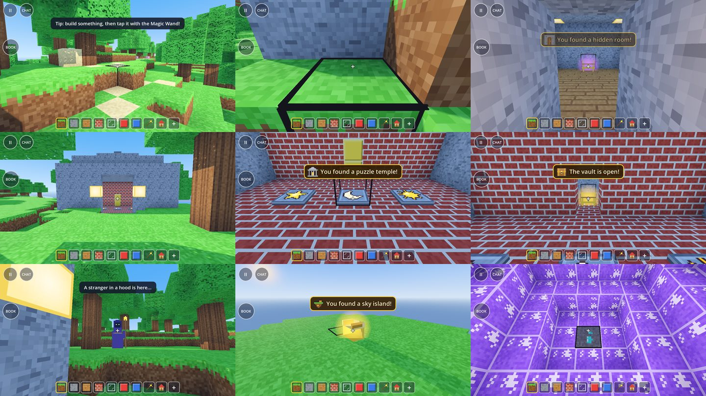

# M2 Task 16: Secrets and treasures (owner feedback #20)

Owner, 2026-09-24: "most important we need secrets, surpices, hidden treasures and similar exciting things".
Spec §12.16 (with §5.7, §6, §13.2, §13.5), plan Task 16. Built in an isolated worktree from `2430164`
(branch `m2-survive-the-night`), commits `d204c08`, `746c3f2`, `b4f7454`, `43750ed`, `c90e091`, `66a7cb9` (docs)
and the last fix (the Wanderer waits through the dusk).
The lead's mid-task additions from the child-psychology research (picture riddles, a secret chime, a
dog-digging hook, explorer bots' `notice`) are built in; see rulings 9–12.

*Left to right, top to bottom: the X over a buried treasure; the hidden room's stairs; the hidden room after
the knock (lamps, a chest glowing epic purple); a puzzle temple (stepped roof, lamps by the door, the yellow
vault door inside); the plates with their sun, moon and star; the open vault (a legendary gold glow); the
Wanderer at dusk; a sky island's golden chest; inside a crystal geode.*

## What was built

### Secrets in the terrain (`world/generators/secret_rules.gd`, `SecretRules`)
Every 128 × 128 area gets its secrets from the world seed and the area alone: six attempts in a fixed
order (each draws its random numbers first, so terrain checks never shift the sequence), a structure is
kept only when it fits.

| Kind | Chance per attempt | What it is | Found when |
|---|---|---|---|
| Buried treasure | 0.8 and 0.5 | an X of pebbles (sand, 9 blocks) on the grass, a chest 2–4 blocks under it | its chest is opened |
| Hidden room | 0.5 | a 5 × 3 × 5 stone room 9 under the ground: plank floor, a lamp in every corner, a chest, sometimes (½) a riddle note; stone stairs come down from the grass to a dead end — a 2-block **fake wall** | the fake wall is knocked open, or someone stands inside |
| Puzzle temple | 0.35 | an 11 × 11 stone hall on a foundation, brick floor, stepped roof with a golden top, lamps by the door, three **pressure plates** painted sun / moon / star, a note with their order, a vault behind a yellow door | someone walks in; the vault opens when the plates are stepped on in the note's order |
| Sky island | 0.25 | a round floating island (radius 4–6, 24+ above the ground, 72–160 high) with a golden chest | someone stands on it |
| Crystal geode | 0.6 | a hollow ball of glowing crystal (radius 4–5, centre −28 to −35) with 3 diamonds in its shell | someone is inside |

- Measured over 144 areas of seed 12345: 118 buried treasures, 64 geodes, 41 hidden rooms, 29 sky islands,
  24 temples — about 1.9 secrets per area ("a few").
- Never in water or a river (land kinds), never within 24 blocks of the world spawn, never on each
  other's ground (footprints 4 apart), and every box stays inside its own area.
- A structure is a list of boxes filled in order. The generator writes the boxes that reach into a chunk,
  last (after trees), clipped to the chunk; high sky chunks get them too. Because each structure stays in
  its area, a chunk looks at one area's few secrets, and chunks meet without seams (tested per kind across
  every chunk it touches). `MeadowsGenerator.reference_block` includes them.
- Thread safety: one `SecretRules` per generator, shared by the worker threads; its per-area cache sits
  behind a mutex (256 areas).

### Things, finds and the host's decisions (`world/secret_director.gd`, `SecretDirector`)
The sandbox adds it on every peer as node `Secrets` (spawner and RPCs line up). The host:
- spawns a secret's things for everyone within 40 blocks (sideways) of a player and removes them beyond 64:
  **chests** (`TreasureChest`), **riddle notes** (`RiddleNote`), a temple's **plate pictures**
  (`TempleMarks`); at most 48. One shared mesh per kind, one glow material per rarity, all on physics layer
  10 (value 512), which only tap rays look for.
- notices finds (presence boxes, a knock, an opened chest) and shows the finder and every player within 24
  blocks a banner with a sparkle sound, counting it in each one's Secret Book;
- rings the **secret chime** once per secret per world when a player comes within 12 blocks;
- decides every request (Session section "M2 Task 16"): open a chest (reach; once per world; a temple's
  chest is locked until solved), knock on a fake wall (all joined fake-wall blocks open; the hidden room
  is found), answer the Wanderer;
- keeps the surprises' clock: counts dusks and nights (saved), brings the Wanderer, drops shooting stars;
- rewards golden animals (`catch_golden`, `reward_golden`).
Chest state (`opened`, `locked`) is synced; LAN guests get the opened chests' ids (their treasure-map
compass) and ask the host for the Secret Book's world counts.

### Surprises while playing (`core/rules/surprise_rules.gd`, `SurpriseRules`)
- **The Wanderer**: the first dusk of a world always, then about 1 dusk in 3. He appears 6–9 blocks from a
  player on ground at the player's level that the player can see (grid ray), asks a riddle with three
  picture answers, stays 4 minutes. A wrong answer: "Hmm, not quite! Try again." The first right answer is
  rewarded once (wanderer loot), and he vanishes in sparkles. Meeting him counts in the Secret Book.
- **Shooting stars**: the first night always, then about 1 night in 2, 20–100 s after nightfall; a star
  streaks down (every peer sees it) and lands 20–40 blocks from a player on dry ground, leaving a meteor
  (dark rock, 4 glowing crystals). Walking up to it (5 blocks) finds it.
- **Golden animals**: about 1 wild herd in 20 has a golden first animal (one shared gold material, a
  twinkle every 1.4 s). It runs from anyone within 7 blocks at 1.4 × its speed but never faster than 5
  (a walking child does 6), is never tamed, and a tap with anything in hand catches it: a pile of gold
  (60–100 × 2^(u−1)) in Survivor, a golden trophy in Sandbox. A caught one never comes back golden in that
  world.

### Loot (`core/rules/loot_rules.gd`, `LootRules`)
Deterministic per chest (world seed + the chest's cell). Gold only in Survivor, × 2^(u−1):

| Kind | Gold | Blocks (one of) | Map | Potion | Better tool | Decoration |
|---|---|---|---|---|---|---|
| buried | 20–60 | iron 4–8, gold 2–5, coal 6–12 | 35 % | 25 % | 15 % stone tier | 20 % |
| room | 40–90 | gold 3–6, diamond 1–3, iron 6–10 | 30 % | 30 % | 25 % stone/iron | 35 % |
| temple | 70–120 | diamond 2–4, crystal 2–4 | 20 % | 40 % | 40 % iron/crystal | always |
| sky | 100–150 | diamond 3–5, crystal 3–6 | 30 % | 30 % | 50 % iron/crystal | always |
| wanderer | 30–60 | crystal 2–4, gold 2–4 | 50 % | 50 % | — | 30 % |
| pinata (§13.5 hook) | — | planks, glass, toy colours | — | 60 % | — | — |

Decorations are the golden trophy (TROPHY 34) and the golden lamp (GOLD_LAMP 35, glows). The rarity is the
best thing inside (grey, green, blue, purple, gold — §13.2) and colours the chest's glow. Treasure-only
things (trophy, lamp, treasure map) are in no palette row and `/give` refuses them ("That is only found in
treasure. Go exploring!").

### The Secret Book, banners, the compass, riddles
- **BOOK** button: left column under MIRROR (14, 212), 90 × 90, on every device. The page: a slot per kind
  of secret with its picture, name and account-wide count once found, "???" until then; "In this world: N
  of M secrets found in the places you explored"; a shelf of the treasure-only things found (tap one to
  hold it).
- **Banners**: golden, top centre under the toasts, with the secret's picture; they queue ("You found a
  hidden room!", then "Treasure! 85 gold, 6 Diamond, Golden Trophy").
- **Treasure map**: while held, a compass (top right, left of the buttons) points to the nearest buried
  treasure not opened yet (looked up once a second) with the distance. A map found in a chest goes into the
  selected hotbar slot, so the arrow shows at once. In Survivor, opening a buried chest uses one map up.
- **Riddle panel**: notes show their text and pictures (a temple's with arrows between); the Wanderer's
  three answers are 150 px picture buttons with a word under each.
- **Taps** (`SecretTaps`, checked first in `BlockInteractor.place_at_screen`, whatever is in hand): chest →
  open, note / Wanderer → the panel, golden animal → catch, fake wall → knock. Things behind a block can't
  be tapped (dig a buried chest out first).

### Assets and tools
- Blocks FAKE_WALL 32 (stone with a faint crack), PRESSURE_PLATE 33 (1/8 high), TROPHY 34, GOLD_LAMP 35
  (glows) in tiles (6..7, 6) and row 7 of both atlases (only those tiles changed; the water waves stay
  identical). Item TREASURE_MAP 170, icon at (4, 7) of the block atlas.
- `data/secrets/pictures.png` (24 pictures, `tools/make_secret_pictures.gd`), 8 sounds
  (`tools/make_secret_sfx.py`): sparkle, chime, knock, chest_open, star_fall, star_land, plate_click,
  plate_wrong. Original work (credited).
- `/secret [treasure|room|temple|island|geode]` (Sandbox cheat): the nearest secret nobody found, with a
  `/tp` next to it.
- `tools/secrets_smoke.gd` (headless end to end), `tools/secrets_shots.gd` (windowed screenshots).

## Tests (RED → GREEN)
Every rule was written test-first and watched failing for the right reason (missing ids and classes, then
wrong values). The director's integration tests were also checked by mutation: breaking "open once" and
the plate order made them fail.

| File | Tests | What |
|---|---|---|
| `tests/unit/test_secret_rules.gd` | 20 | determinism, other seeds differ, 1.5–5 per area, every kind somewhere, inside own area, never in water / spawn clearing / on each other, ids, each structure's blocks, the temple's roof, fake-wall group, nearest buried treasure, secrets near a point |
| `tests/unit/test_meadows_generator.gd` (+2) | | one of each kind generated across every chunk it touches equals the rules (seam-free); reference_block includes secrets |
| `tests/unit/test_loot_rules.gd` | 11 | per-chest determinism, gold ranges × universe, Sandbox without gold, rare blocks, decorations, shares of maps/potions/tools/decorations, rarity, treasure-only never picked or given, golden reward, piñata, banner text |
| `tests/unit/test_surprise_rules.gd` | 13 | Wanderer schedule, riddles (3 pictures and words), spots and visible placement, stars' schedule, landing spot, meteor (never into a build), golden herds, fleeing, plate order, chime, compass |
| `tests/unit/test_secret_state.gd` | 5 | save round trip, broken saves, caps, exploring, found / total |
| `tests/unit/test_secret_pictures.gd` | 6 | every picture drawn and different, shared textures and 3D materials, riddle words, sounds exist |
| `tests/integration/test_secrets_in_world.gd` | 15 | chests near players, opens once (and after a reload), Sandbox shelf, treasure map, temple order, knock, the Wanderer's single reward, his waiting through the dusk (and missing at night), the falling star (not into a build), golden animals, book counts, the chime once + bots, /secret, shared meshes |
| `tests/integration/test_secret_hud.gd` | 9 | BOOK button spot, "???" slots, world line, the shelf, banners queue, picture answers, a temple note, the compass, Back |
| `tests/integration/test_golden_animals.gd` | 3 | shared gold material, never tamed, runs from anyone close |
| plus ids, library, palette, profile, world meta, chat commands | | the new ids, tiles, `/give` refusal, the Secret Book in the profile, secrets in the world save, `/secret` |

Full suite: 637 passing before, **731 passing** after, `tests/run_tests.sh` exit 0.

## Generator bench (`tools/bench_generator.gd`, seed 12345, 8 × 9 × 8 chunks)
The bench now also times every chunk with the secrets off, in alternating order (a busy PC slows both
alike), and the one-time placement of an area. Final run (load average 18–19; other agents building):

| Chunks | Secrets off, avg | Secrets on, avg | Worst on |
|---|---|---|---|
| surface (213) | 1.94–2.00 ms | 1.96–2.02 ms | 4.0–5.3 ms |
| underground (256) | 1.12–1.17 ms | 1.13–1.18 ms | 3.3–3.6 ms |
| sky (107) | 0.77–0.79 ms | 0.77–0.79 ms | 1.1–1.4 ms |

Placing a new area's secrets: 0.15 ms on average, 0.45–0.65 ms worst, once per area (then cached).
Before the task (same seed, load 41–45): surface 3.05–7.67, underground 1.80–4.61, sky 1.17–2.79 ms avg —
the machine's load, not the code; the same-run comparison above is the measurement.

## End to end in the real game (no editor, no emulator)
- `tools/secrets_smoke.gd` (headless, a new Sandbox world of seed 12345): 28 checks pass — the X and the
  chest pocket in the generated terrain, the chest comes near and opens (found, banner), the generated fake
  wall knocks open, the temple's plates, locked chest, the note's order opening the yellow vault door, the
  Wanderer at dusk rewarded once, and the save.
- The last smoke run before the report found a third fault (the Wanderer never came while the player was
  inside the temple at dusk); fixed test-first (ruling 13), and the run passes again with the player walking
  out of the door first.
- `tools/secrets_shots.gd` (windowed): the screenshots above. They found two faults, both fixed test-first:
  the Wanderer stood behind the temple's wall (now: ground at the player's level and a clear line of sight),
  and the vault door read as gold ore (now bright yellow; a stepped roof, golden top and door lamps make the
  temple a landmark).

## Rulings (decisions on the owner's behalf; cost if wrong)
1. **Decorations are the blocks TROPHY 34 and GOLD_LAMP 35**; the item ids 171 / 172 stay unused. A block id
   already sits in hotbars and inventories; a second id would split counts. *Cost:* add two ids and an
   item → block mapping in the interactor.
2. **One treasure map = a compass to the nearest unopened buried treasure** (inventories hold ids, not
   per-map data). Survivor uses a map up when its holder opens a buried chest; Sandbox keeps it. *Cost:* a
   per-map target needs item data in inventories.
3. **A found map goes into the selected hotbar slot** (the arrow shows at once). *Cost:* the child's block
   in that slot has to be picked again (palette).
4. **Treasure is found, never picked or given**: no palette row, `/give` refuses; Sandbox finds wait on
   the Secret Book's shelf (tap one to hold it). *Cost:* none known; the shop (Task 7) must also skip them.
5. **The hidden room's entrance is a stone stairway down from the grass** to a 2-block dead end: the fake
   wall. Kids spot the stairs and wonder about the dead end; a knock opens it. *Cost:* a stairway is less
   hidden than a wall in a cave.
6. **A temple's chest stays locked until the plates are solved**, even if someone digs in. *Cost:* none.
7. **The vault door is YELLOW toy blocks** (gold ore looked like ore and was worth mining). *Cost:* looks
   plastic in the realistic style.
8. **Plates press by stepping on them** (the host checks feet 10 times a second); a tap does nothing
   special. *Cost:* a flying player hovering over a plate never presses it.
9. **Picture riddles (lead)**: sun, moon and star painted on the plates and drawn on the note in order;
   the Wanderer's answers are big picture buttons with a word; texts ≤ 40 characters. *Cost:* the riddles
   are easy for readers.
10. **The secret chime (lead)**: once per secret per world within 12 blocks (3D), a non-positional chime and
    a twinkle around the player — never at the secret. *Cost:* none known.
11. **Dog digging hook (lead)**: `SecretRules.nearest_buried(pos, opened)` (also the map's compass).
12. **Explorer bots (lead)**: on each chime the director calls `notice(point, text)` on a node in group
    `bot_director`, else on a sandbox child `BotDirector`, guarded by `has_method`. Task 15 must add one of
    the two. *Cost:* a silent no-op until then.
13. **The Wanderer: the first dusk always, then ~1 in 3; wrong answers may try again; one reward per visit**.
    Kind to children, still rare. A due visit waits the whole dusk (about 2 minutes) for a spot next to any
    player that is at their level and in sight, so a child who is indoors when dusk starts still meets him
    outside; at nightfall a visit that found no spot is missed (the final smoke run found this: the player
    stood inside the temple and the visit was lost). *Cost:* a guessed answer can win (3 tries at most).
14. **Stars: the first night always, then ~1 in 2**, landing 20–40 blocks from the first player on dry ground.
15. **Golden animals ~1 herd in 20, catchable (≤ 5 m/s, a child walks 6)** with anything in hand.
16. **Secrets pay gold in M2** (the spec's §12.7 listed secrets under M3 sources). *Cost:* more gold early in
    Survivor; the ranges are the spec's 20–150.
17. **Universe fixed at 1** (`SecretDirector.UNIVERSE`) until M3 passes the world's universe.
18. **Found by presence** for temples, sky islands, geodes and rooms (a room also by the knock); buried
    treasure only by opening. Banners also for players within 24 blocks (co-op).
19. **The X is sand ("pebbles")**, not flowers: there is no flower block. *Cost:* a flower block later.
20. **The golden trophy is a cube** with a cup in relief, not a cup-shaped mesh. *Cost:* a mesh model later.
21. **The BOOK button shows on every device** (there is no key). *Cost:* one more button on desktop.
22. **Secret things use physics layer 10 (value 512)**. *Cost:* renumber if another task took it.
23. **A meteor lands only in air and natural ground** (grass, dirt, sand, stone, leaves, deep stone): it never
    smashes a child's build, water or a tree trunk (found in review; test-first). *Cost:* a meteor on a
    build is missing some blocks.
24. **Worlds saved before this task** get secrets in every chunk that is regenerated; chunks the player
    changed keep their saved blocks, so a structure crossing one is cut there. *Cost:* now and then a half
    structure next to an old build.

## Costs to keep an eye on
- The director keeps its own `SecretRules` (its cache is separate from the generator's). The treasure
  map's first lookup places up to 25 areas (about 4 ms on the desktop, once, on the main thread); `/secret`
  scans about 120 areas (about 18 ms desktop, once per command, a cheat). Measure on the emulator; if needed,
  warm one area per frame.
- Per host tick (0.5 s): the areas within 40 blocks of each player (cached), a few distance checks, at most
  48 things; plates every 0.1 s only next to an unsolved temple.

## Hooks and notes for the lead (merge)
- **Golden slimes (Task 4)**: decide with an id rule like `SurpriseRules.is_golden`, make them flee with
  `SurpriseRules.golden_flee` / `golden_speed`, and on a catch or defeat call
  `sandbox.get_node("Secrets").reward_golden(peer_id, pos, id)` (gold or a trophy, once per id, banner).
- **Explorer bots (Task 15)**: ruling 12.
- **Party Piñata (§13.5, M3)**: `LootRules.roll(&"pinata", key, u, survivor)` and the director's `_give(peer,
  loot)` (inventory, gold, banner); the falling-star streak (`ShootingStar.fall`) shows how a drop falls.
- **Pet dog digging (M3)**: ruling 11; `_secrets.state.opened` holds the opened chests.
- **Task 3 (gathering)**: breaking FAKE_WALL should give STONE, PRESSURE_PLATE nothing (or stone), TROPHY and
  GOLD_LAMP themselves. Chest loot goes into `Session.inventory_of(peer)` on the host; the hotbar/palette
  sync Task 3 adds must also pick that up (after `SecretDirector._give`).
- **Task 6**: the map's icon is (4, 7) of the block atlas (move it to `item_icons.png` row 4 if wanted);
  `LootRules.RARITY_COLORS` duplicates the tier colours — keep one table; tier tools and potions from chests
  only enter inventories once they are in `ItemIds.ALL`.
- **Task 7**: the shop must never sell `LootRules.TREASURE_ONLY`.
- **Task 12**: `tools/secrets_smoke_steps.gd` can become the tour's "secrets" check.
- **Likely merge conflicts**: `block_ids.gd` (COUNT), `item_ids.gd` (ALL), `test_block_ids.gd` (COUNT 36),
  `test_item_ids.gd` / `test_block_palette.gd` (treasure-only rows), `block_library.gd` TILES, the atlas tools
  and PNGs (regenerate both atlases after merging tiles), `audio.gd` SOUNDS, `session.gd` / `hud.gd` end
  sections, `sandbox.gd` (director, HUD, save, pets, Back), `block_interactor.gd` (first line of
  `place_at_screen`), `animal.gd` (golden section), `chat_commands.gd` (CHEATS, COMMANDS).

## What to check on the emulator
1. BOOK button under MIRROR; the page's "???" slots and the world line; the shelf after a find.
2. `/secret temple` then the `/tp`: the temple's roof and door lamps, the plate pictures upright when walking
   in, the note (tap), stepping sun/moon/star in the note's order: clicks, "Click! 1 of 3", the yellow door
   vanishing, the chest's glow, opening it, the banners. Wrong order: "Clunk!".
3. `/secret room`: down the stairs, tap the dead end: knock, crumble, the lit room, the chest.
4. `/secret treasure`: the X; dig down 2–4 blocks; tap the chest (not before digging).
5. `/secret island` (fly up), `/secret geode` (dig or `/tp` in): the found banners.
6. `/time sunset` for the Wanderer (then tap him; picture answers), `/time night` for a shooting star (it
   falls 20–100 s into the first night).
7. A golden animal (rare: walk around, or use seed 12345's herds); chase and tap it.
8. The chime near an unfound secret; the treasure map's compass after a chest gives a map.
9. Frame times while flying over secrets and near several chests (both styles); the chests' glow in the
   realistic style; LAN: a guest opening a chest, the host's Secret Book.

## How to find a secret quickly
- In any Sandbox world: `/secret` (any kind) or `/secret temple|room|treasure|island|geode`, then the `/tp`
  it prints.
- Seed 12345 (`--tour-seed=12345` on the desktop, or `Game.new_world_seed`): buried treasure chest at
  (80, 33, −31), hidden room's fake wall at (57, 30, 34), puzzle temple at (−78, 28, 60).
- Headless end to end: `XDG_DATA_HOME=/tmp/easycraft-smoke-secrets godot --headless --path . --script
  res://tools/secrets_smoke.gd` (a fresh folder each run).
