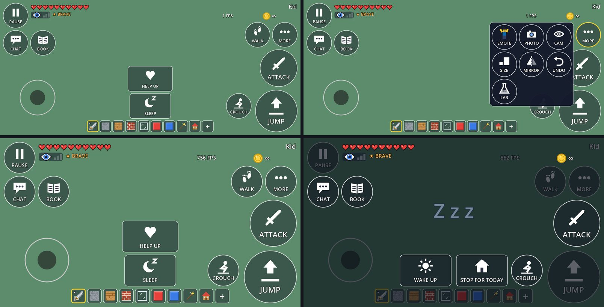

# M2 Task 17: the kid-friendly HUD pass (notes)

Plan Task 17, first bullet ("icon-first HUD buttons … rarely used buttons into a small 'more' menu …
Test: every HUD button meets its minimum size"); spec §5.15 (accessibility line), §16 (research quick
wins); research O1 (icon-first buttons) and A4 (button size and layout), R1 (buttons too small and too
many). Built by a background agent in its own worktree, cut from `m2-survive-the-night` at `df351de`,
without the editor or the emulator (commit `ecaeba2`, then these docs). The M3 desert and
universe-ladder agents ran in parallel.



*Top: the emulator's 20:9 screen (its 1600 × 720 canvas) awake with a sword, SLEEP and HELP UP showing;
the same with MORE open. Bottom: a 16:9 phone (1334 × 750) awake, and asleep (WAKE UP and STOP FOR TODAY).
Made with `tools/hud_shots.gd` over a plain background.*

## What was built

| Piece | Where | What it does |
|---|---|---|
| Layout table | `ui/hud/hud_layout.gd` (`HudLayout`) | Every HUD control's spot in one const Dictionary `SPOTS` (name → anchor, offset, size in the 1280 × 720 design space); `place(c, name)`, `rect(name, screen)`; `mirrored(spot)` (left-handed) and `scaled(spot, f)` (bigger buttons) for M5 — no settings built. Sizes: `JUMP` 225, `ATTACK` 200, `BUTTON` 135; the test bars `MAIN_MIN` 200 and `BUTTON_MIN` 135. |
| Pictures | `ui/hud/hud_icons.gd` (`HudIcons`) | 26 pictures drawn in code into the button's own canvas item (arrows, a crouching figure, a sword, footprints, a wing, a ghost, the moon, a ringed planet, a snail, blocks, an eye, undo, mirror, a figure, a camera, a flask, a book, pause bars, a speech bubble, dots, moon and Z, sun, house, heart). No textures, no materials; redrawn only when a button changes. `SYMBOLS`, `knows(symbol)`, `draw(ci, symbol, rect)`. |
| Buttons | `ui/controls/touch_button.gd` | `symbol`: with one, the button draws its picture in the top part and its word under it (outlined, shrunk to fit the button: about a sixth of its height, 22 px on a 135 button, 34 on JUMP). One `StyleBoxFlat` per button, reused (it was made on every redraw). `icon_rect()`, `word_size()`, `_draw_icon()` (the emote button draws the player's figure there). Hotbar slots draw as before. |
| MORE panel | `ui/hud/more_panel.gd` (`MorePanel`) | A box of 135 px picture buttons (3 columns) left of the MORE button, growing left and down. While open it hears touches before every HUD button: a touch on the box stays there, a touch anywhere else closes it and does nothing else; lifts and drags pass (the finger that opened it). `add(b, closes)`, `buttons()`, `open/close/toggle/is_open`, closes on pause. |
| HUD | `ui/hud/hud.gd` | Every spot from `HudLayout`; the MORE button and panel (`more_button`, `more`, `close_more()` for Android Back); CAM, SIZE, MIRROR, UNDO, the emote button, the photo button and LAB live in the panel (`_add_more_panel`, in that order after EMOTE and PHOTO); EMOTE and PHOTO close it; the shop and the Totem's panel close it; pictures follow the words (JUMP ↔ UP, WALK/FLY/GHOST/MOON/ZERO-G/SLOW, SLEEP ↔ WAKE UP); `_raise_overlays()` keeps the MORE panel, the emote wheel and the palette above the buttons whenever a section adds some; `set_theater_open(on)` (rule 8). |
| Chat | `ui/hud/chat_panel.gd` | The CHAT button from the table (under pause), with a speech bubble; the chat bar starts right of pause; the choices and the history start right of BOOK and stop left of WALK and MORE. `BUTTON_POS` / `BUTTON_SIZE` are gone (the table has them). |
| Knock-out fade | `ui/hud/knockout_overlay.gd` | The message and tip sit in the screen above its bottom 220 px, so GET UP (135 tall now) is under the words; `words_rect()`. |
| Emote wheel | `ui/avatar/emote_wheel.gd`, `emote_button.gd` | Fix: the finger that opened the wheel (on the button's touch-down) lifting no longer closes it (rule 9). The emote button draws the figure in the picture's place, with EMOTE under it. |
| Compass | `ui/hud/treasure_compass.gd` | Placed from the table (left of WALK). |
| Photo chip | `ui/photo/photo_chip.gd` | The unused CAMERA glyph is gone (the HUD's photo button draws `HudIcons`' camera). |
| Sandbox | `scenes/sandbox.gd` | Android Back closes MORE (after the palette); the Theater's panel tells the HUD when it shows; MORE open counts as an overlay for the Theater's native view. |
| Pictures of the HUD | `tools/hud_shots.gd`, `tools/hud_shots_steps.gd` | Windowed; PNGs of the HUD at 1600 × 720 and 1334 × 750 (awake, MORE open, flying, asleep) and a sheet of every picture into `user://hud_shots/`. |

## Before and after (1280 × 720 design space, a 16:9 phone; 20:9 phones add room in the middle)

Before (sizes in px): II and CHAT 76, MIRROR / BOOK / emote / photo / LAB 90, WALK / SIZE / CAM / UNDO 94,
DOWN / CROUCH 110, ATTACK 130, JUMP 165, SLEEP 220 × 76, HELP UP 240 × 88.

```
+------------------------------------------------------------------------------+
|[II][CHAT] ♥♥♥♥♥♥♥♥♥♥ ★BRAVE [ wave / boss ]                   Kid          |
|           (eye)                                       (gold ∞)             |
|[MIRROR]           potions      (toasts)       [photo]   [WALK]            |
|[BOOK][emote]                                  [ LAB ]   [SIZE]            |
|                                                         [CAM ]            |
|                                                         [UNDO]            |
|                               [HELP UP]    [ATTACK]                       |
|   joystick area               [ SLEEP ]          [ JUMP ]                  |
|                        [ hotbar 1..9 + ]    [DOWN]          FPS           |
+------------------------------------------------------------------------------+
```

After (JUMP 225, ATTACK 200, every other button 135; SLEEP / WAKE UP / STOP 220 × 135, HELP UP 240 × 135):

```
+------------------------------------------------------------------------------+
|[PAUSE] ♥♥♥♥♥♥♥♥♥♥       [ wave / boss ]                       Kid ●        |
|[     ] (eye) ★BRAVE                         FPS      (gold ∞)              |
|         potions        (toasts)          [compass][ WALK ][ MORE ]         |
|[ CHAT ][ BOOK ]                                  [      ][      ]         |
|[      ][      ]                                         [ ATTACK ]        |
|                         [ HELP UP / GET UP ]           [        ]        |
|   joystick area          [SLEEP] or [WAKE UP][STOP] [CROUCH][  JUMP  ]    |
|   (400 × 400)            [ hotbar 1..9 + ]          [ DOWN ][   UP   ]    |
+------------------------------------------------------------------------------+
MORE (opens left of MORE, over the right side):  [EMOTE][PHOTO][ CAM ]
                                                 [SIZE ][MIRROR][UNDO]
                                                 [ LAB ]   (Sandbox, touch)
```

## Tests, RED → GREEN

- `tests/integration/test_hud_layout.gd` (new, 11 tests; RED: it did not parse — `Hud` had no `more`,
  `more_button`, `set_theater_open`, `close_more`, and `KnockoutOverlay` no `words_rect`):
  - `test_every_button_is_big_with_a_picture_and_nothing_overlaps` — **the task's test**: on 2400 × 1080
    and 1334 × 750, Sandbox and Survivor, awake (SLEEP and HELP UP showing, a sword in hand) and asleep
    (WAKE UP and STOP FOR TODAY): every visible HUD button (the hotbar's slots excepted, rule 3) is a
    `TouchButton` with a known picture and a word; JUMP and ATTACK ≥ 200 (JUMP ≥ 225), the rest ≥ 135 on
    the short side; on screen; no two overlap; none covers the joystick's area or the hotbar; the hearts,
    eye, Brave badge, gold, name, wave line, boss bar, potion chips, compass and FPS are on screen and
    clear of every button and of each other (the wave line and the boss bar share a spot). Mutation
    check: ATTACK 130 and CROUCH moved onto JUMP → 16 failures naming them; restored.
  - `test_the_rare_buttons_live_in_the_more_panel` — EMOTE, PHOTO, CAM, SIZE, MIRROR, UNDO (+ LAB in
    Sandbox) in the panel, in that order; JUMP, ATTACK, CROUCH, PAUSE, CHAT, BOOK, WALK, MORE on screen.
  - `test_the_more_panel_opens_beside_more_with_big_buttons` — both screens and modes: on screen, left of
    MORE and clear of it, MORE lit while open, every button ≥ 135, inside the box, no overlap, a picture
    and a word; the box blocks the look area; MORE again closes it.
  - `test_an_open_overlay_closes_the_more_panel` — the shop, the Totem's panel, Android Back.
  - `test_the_knock_out_words_stay_above_get_up` — both screens: the message and tip end above GET UP
    and start under the toasts.
  - `test_the_theater_keeps_its_buttons_to_itself` — both screens: with the Theater open, no HUD button
    covers NEXT / BACK / EXIT / the channels; BOOK, WALK and MORE come back after.
  - `test_every_spot_is_on_a_16_9_and_the_emulators_screen_and_mirrors_onto_it` — every table spot on
    1280 × 720 and 1600 × 720; mirrored spots too, mirrored across the middle; `scaled` grows from the
    same corner.
  - Real touches in a 1280 × 720 SubViewport: `test_a_tap_on_more_opens_it_and_a_tap_on_emote_opens_the_wheel`
    (the wheel stays open after the finger lifts, no button stays held) and
    `test_a_tap_outside_the_box_only_closes_it` (SIZE keeps it open; a tap on JUMP only closes it, no jump;
    the next tap jumps).
  - `test_every_picture_draws` — every `HudIcons` symbol draws without an engine error; the WALK button's
    pictures are all known.
- `tests/integration/test_emote_wheel.gd`: `test_the_finger_that_opened_the_wheel_can_lift` — RED: "still
  open after the opening finger lifts" failed and no emote was chosen; GREEN after the fix.
- Updated (numbers or spots changed, intent kept): `test_hud_attack_button` (200 px, above JUMP, clear of
  JUMP / DOWN / CROUCH / WALK / MORE / hotbar), `test_hud_lab_button` and `test_hud_photo_button` (in the
  MORE panel, 135, their pictures; photo closes the panel), `test_emote_wheel` (the button waits first in
  the panel and opens the wheel), `test_secret_hud` (BOOK beside CHAT under the hearts, 135),
  `test_hearts_hud` (right of pause, above CHAT; clear of WALK, MORE, the wave line and the boss bar),
  `test_brave_badge` (under the hearts right of the eye; clear of the wave line and boss bar too),
  `test_boss_hud`, `test_gold_counter`, `test_wave_hud`, `test_potion_timers` (lists name the on-screen
  buttons instead of the ones that moved into MORE), `test_online_menus` (the dot is clear of WALK and
  MORE at their real size).
- Kept as they were and passing: the shop and Totem panels above every button (`test_hud_overlays`), the
  palette fits above the hotbar (`test_block_palette`, `test_palette_armory`), WAKE UP / STOP FOR TODAY
  equal and side by side (`test_sleep_and_save`), HELP UP / GET UP big and clear (`test_revive_hud`),
  CROUCH on DOWN's spot (`test_hud_stealth`), photo mode hides the HUD (`test_photo_mode`), touches let go
  on pause (`test_touch_pause`), the danger arrow (`test_hud_stealth`).
- Suite (`tests/run_tests.sh`, exit 0 both times): before, 258 scripts / 2529 tests, 2528 passing (1 risky:
  `test_an_unowned_id_is_not_placeable` does not assert, not ours); after, 259 scripts / 2540 tests,
  2539 passing (the same risky one), 402 s at load ~15.

## Rulings (decided on the owner's behalf)

1. **The split.** On the screen: the joystick, JUMP (UP), ATTACK (with a weapon), CROUCH (DOWN), the
   hotbar and palette, PAUSE, CHAT (the quick-chat wheel is inside it), BOOK, **WALK/FLY** and MORE; in
   context SLEEP / WAKE UP + STOP FOR TODAY and HELP UP / GET UP. In MORE: EMOTE, PHOTO, CAM, SIZE,
   MIRROR, UNDO, LAB. WALK/FLY stays on the screen: flying is the Sandbox's favourite thing, its button is
   the mode's only indicator (spec §9.7) and Survivor's paid Fly hangs on it. *Cost if wrong:* moving
   WALK into MORE is one line in `_add_more_panel` and one spot freed.
2. **ATTACK is 200, not 225.** On a 16:9 phone the right edge holds the gold line, MORE's row (135),
   ATTACK and JUMP (225) with 10–16 px gaps; 225 + 225 does not fit under MORE. 200 px is about 1.8 cm on
   a Pixel 8 (JUMP 225 ≈ 2.0 cm). The test's bar for both is 200 (`MAIN_MIN`). *Cost if wrong:* a
   slightly smaller ATTACK; M5's size setting (`HudLayout.scaled`) can grow it on bigger screens.
3. **The hotbar's slots stay 62 px and are not held to 135.** Nine slots and "+" at 135 would be over
   1,350 px wide, wider than the screen; the slots are a strip of items the child picks from, not action
   buttons. The layout test checks the hotbar as one strip that no button covers. *Cost if wrong:*
   small targets for the youngest; M5's button-size setting or fewer, bigger slots.
4. **How MORE behaves.** A box beside the MORE button (not the middle of the screen, so a child sees
   themselves shrink or grow); a tap outside it closes it and does nothing else (no jump, no block);
   SIZE, CAM, MIRROR, UNDO and LAB leave it open so the change shows (SIZE says TINY, MIRROR lights up)
   and UNDO can be pressed again; EMOTE and PHOTO open something else and close it; Back, pausing, the
   shop and the Totem close it. *Cost if wrong:* one `closes` flag per button in `_add_more_panel`.
5. **New spots.** CHAT moved under PAUSE (both 135), BOOK beside CHAT; the hearts, the eye and the Brave
   badge are right of PAUSE — the badge under the hearts, right of the eye (right of the hearts it ran into
   the wave line and the boss bar on a 16:9 phone); the treasure compass left of WALK; FPS left of the gold
   (JUMP has the corner); SLEEP (and the WAKE UP / STOP pair) above the hotbar, HELP UP / GET UP above them;
   the knock-out words 220 px higher so GET UP fits under them; the chat's choices and history right of
   BOOK and left of WALK / MORE. *Cost if wrong:* numbers in one table.
6. **The joystick's area is 400 wide (was 440)** so WAKE UP fits beside it, centred with STOP FOR TODAY, on
   a 16:9 phone. On 16:9 the hotbar's first slots still overlap the area's bottom right corner (x 303–400;
   303–440 before); the slots win those touches, as before. *Cost if wrong:* 40 px less for the left thumb.
7. **Pictures drawn in code, no icon atlas.** Chosen: `HudIcons` (shapes into each button's canvas item,
   scale with the button, no import, no credit, no material). Rejected: a CC0 icon atlas (Kenney) — fixed
   resolution, an import and a credit, and the words and sizes would still be code. *Cost if wrong:* the
   M5 art pass can draw an atlas region behind the same `symbol` names.
8. **The Theater has the middle.** On a 16:9 phone the Theater's side columns reach BOOK (left) and WALK
   (right); while its panel shows, BOOK, WALK and MORE step aside (JUMP, CROUCH, PAUSE, CHAT and the
   joystick stay). A TouchButton hears a touch before any GUI button above it, so an overlap would have
   pressed both. *Cost if wrong:* no fly switch or book inside the Theater room.
9. **Emote wheel fix (found here).** The wheel opens on the emote button's touch-down and closed at once
   when that finger lifted (it had not seen the finger go down), so on a phone it flashed and vanished.
   It now ignores the lift of a finger it did not see go down, and does not take that lift from others.
10. **Words.** PAUSE (was "II"), MORE, EMOTE and PHOTO are new words; CAM keeps its name (spec and research
    say CAM). STOP FOR TODAY gets a house, WAKE UP a sun, SLEEP a moon, HELP UP a heart, GET UP an arrow.

## Patterns (godot-prompter skills)

- `godot-prompter:hud-system` — kept the HUD under the sandbox's CanvasLayer; labels and indicators
  ignore the mouse. Rejected its GUI `Button`/focus patterns for the in-game controls: they must be
  multi-touch beside a held joystick, so they stay `TouchButton`s reading touches in `_input`.
- `godot-prompter:godot-ui` — chosen: anchors and offsets set in code from one table (`HudLayout.apply`),
  and a container only inside the MORE box (`GridContainer` in a `PanelContainer` growing left from its
  anchor). Rejected: HBox/VBox rows for the screen edges — they cannot pin fixed thumb targets to corners,
  cannot express the joystick's area, and mirroring would mean reversing child orders.
- `godot-prompter:responsive-ui` — kept `canvas_items` + `expand` on the 1280 × 720 base (20:9 phones get
  room in the middle); every spot anchors to its nearest corner or edge. Rejected: `content_scale_factor`
  for the button-size setting (it scales text and everything at once); M5 scales spots (`scaled`).
  Not done: safe-area insets (a punch-hole camera on the long edge) — see "For the lead".

## For the lead: check on the emulator (2400 × 1080; the canvas is 1600 × 720, screen = canvas × 1.5)

Tap centres of everything that moved (landscape, from the top left):

| Button | Screen tap | Canvas rect (1600 × 720) |
|---|---|---|
| PAUSE | (125, 125) | 16..151 × 16..151 |
| CHAT | (125, 343) | 16..151 × 161..296 |
| BOOK | (343, 343) | 161..296 × 161..296 |
| WALK / FLY | (2057, 278) | 1304..1439 × 118..253 |
| MORE | (2275, 278) | 1449..1584 × 118..253 |
| ATTACK (a weapon in hand) | (2226, 545) | 1384..1584 × 263..463 |
| JUMP / UP | (2207, 887) | 1359..1584 × 479..704 |
| CROUCH / DOWN | (1907, 847) | 1204..1339 × 497..632 |
| SLEEP (by a bed) | (1200, 847) | 690..910 × 497..632 |
| WAKE UP (asleep) | (1020, 847) | 570..790 × 497..632 |
| STOP FOR TODAY (asleep) | (1380, 847) | 810..1030 × 497..632 |
| HELP UP / GET UP | (1200, 629) | 680..920 × 352..487 |
| Joystick area | x 0..600, y 480..1080 | 0..400 × 320..720 |
| Hotbar (unchanged) | slot i at (741 + 102 i, 1010); "+" (1659, 1010) | 463..1137 × 642..704 |

The MORE panel (box 990..1439 × 118..567 on the canvas; screen x 1485..2159, y 177..851):

| In MORE | Screen tap |
|---|---|
| EMOTE | (1604, 296) |
| PHOTO | (1822, 296) |
| CAM | (2039, 296) |
| SIZE | (1604, 514) |
| MIRROR | (1822, 514) |
| UNDO | (2039, 514) |
| LAB (Sandbox) | (1604, 731) |

What to look at:
1. The pictures and words read well on the emulator (both styles), and the sizes feel right for a thumb;
   nothing sits under the punch-hole camera in either landscape rotation (no safe-area insets yet).
2. MORE: opens, lights up, closes on a second tap, on a tap anywhere else (no jump, no block placed),
   on Back; SIZE/CAM/MIRROR/UNDO/LAB work from it and leave it open; EMOTE opens the wheel **and the
   wheel stays open** (rule 9) and an emote plays; PHOTO opens photo mode and closing it brings the HUD
   back with MORE closed.
3. Sleeping: WAKE UP and STOP FOR TODAY side by side above the hotbar; GET UP under the knock-out words.
4. The Theater room on the emulator (20:9): nothing overlaps; BOOK, WALK, MORE step aside and come back.
5. The autopilot's frame budget (buttons redraw only on a change, so no change is expected).

Known and left for the lead: the sleep dim (at the toast's index since M1b) covers the buttons added
before the toast (PAUSE, WALK, MORE, JUMP/UP, DOWN, the hotbar) but not the later ones (CHAT, BOOK,
ATTACK, CROUCH), so half the HUD looks dimmed while asleep (visible in the picture above); one fix is
to dim the world only, or everything but WAKE UP / STOP and the messages. The M3 plan's allocations
still name the old spots (LAB right column, emote button left column, photo button top right).
