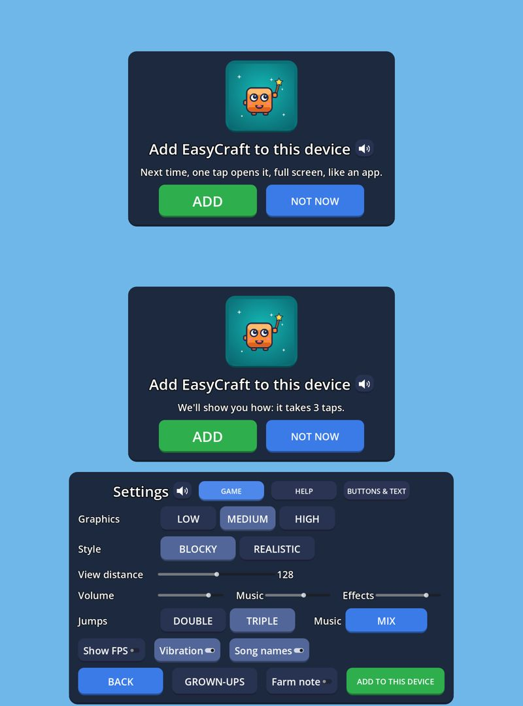

# M7: "Add EasyCraft to this device" inside the game (notes, 2026-09-28)

The owner (2026-09-28): "remember when user start playing, they should get shortcut on the app so next time they just
click and open it" and "it must be very user friendly". The page (`web/shell.html`, the lead's) already offers it on
the loading screen; many players tap PLAY before they notice it, so the game offers the same from its main menu and
from SETTINGS. Done by a background agent in its own worktree (`worktree-agent-a23d2086560bb45f2`, fast-forwarded to
`lead-merge` at `1f37837`, where the web work is). No editor, emulator, adb, godot-mcp, browser or export;
`web/shell.html`, `export_presets.cfg`, `tools/*web*`, `addons/*` and the server untouched. Every change test-first
(RED seen for the reason named, then GREEN). How it works: `docs/DEVELOPMENT.md` §5 "Web", the bullet "Add EasyCraft
to this device in the game".

(Drawn under Xvfb with the Compatibility renderer from a throwaway script: the card at 1600 × 720 under the menu's
130 px logo room, the Safari line, and SETTINGS in a phone browser.)

## What was built

| Part | What | Tests (RED: why it failed first) |
|---|---|---|
| `WebGlue.install_state()`, `parse_install_state()`, `request_install()` (`core/platform/web_glue.gd`) | Ask `window.easycraftApp` (`canInstall`, `needsGuide`, `isInstalled`, `install`) in one guarded `JavaScriptBridge.eval` each; the state comes back as JSON and only a real `true` is true; off the web or on a page without the object: all false, and `request_install()` is false. | `tests/unit/test_web_glue.gd` (+3; RED: the functions did not exist). |
| `InstallOffer` (`core/platform/install_offer.gd`) | Pure rules: `can_offer(f, state)` (a browser, `can_install`, not `installed`) for SETTINGS; `card_due(f, state, played, settings, now, shown)` for the menu's card: after play, once a run, 3 days (`WAIT_SECONDS`) after an answer, never after `MAX_NOT_NOW` = 3 NOT NOWs; `note_not_now` / `note_add`; `shown_this_run`. | `tests/unit/test_install_offer.gd` (9; RED: class not declared). |
| Profile (`core/save/profile_data.gd`) | Two settings: `install_not_now` (0..3) and `install_asked_at` (unix seconds, 0 = never); defaults, round trip, broken values read as none (a count above 3 as 3). | `test_profile_data.gd` (+1; RED: no such key). |
| The card (`ui/menus/install_card.gd`, `InstallCard`) | Picture first: the buddy (`res://icon.png`, the icon the child will look for on the Home Screen) in a rounded teal tile; "Add EasyCraft to this device" with the speaker; "Next time, one tap opens it, full screen, like an app." (Safari: "We'll show you how: it takes 3 taps."); ADD (green, big) beside NOT NOW (blue). 816 × 536 px: fits under the logo on 1280 × 720. | `tests/integration/test_install_offer_menu.gd` (card, lines, picture first, fit, speaker; RED: `InstallCard` not found). |
| Main menu (`ui/menus/menu.gd`) | `_route()` goes through `_show_home()` after the first-launch questions and the welcome cards: the card when `card_due`, else the games. ADD calls `request_install` straight from the tap, starts the 3-day wait and shows the games (Safari's guide opens over them); NOT NOW counts, waits, shows the games. Seams: `install_state`, `request_install`, `save_profile`. | Same file (+9 menu cases: after play, Safari, first visit, played before, ADD, NOT NOW, once a run, never outside a browser, not when nothing can be added, never during the first-launch questions). |
| Played this run (`autoloads/game.gd`) | `Game.worlds_left` counts `quit_to_menu()` (every way back from a world: pause SAVE & QUIT, a visit's leave, online); `Game.change_scene` is the scene change (tests record it). | Same file (+1; RED: no `worlds_left`). |
| SETTINGS (`ui/menus/settings_panel.gd`) | **ADD TO THIS DEVICE** (green) at the end of the last row (BACK, GROWN-UPS, Farm note), visible on every page, only where `can_offer`; after a tap it hides when the page has nothing more to add (Chrome's prompt is used up) and stays on Safari (the guide can be shown again). Also after 3 NOT NOWs. The pause menu's SETTINGS has it too. Seams: `install_state`, `request_install`. | Same file (+4: offered, Safari keeps it, none elsewhere, all three pages fit: 1177 × 711). |

**Full suite** (`tests/run_tests.sh`, 2026-09-28 00:54, 1139 s): **6098 of 6100 pass**, 0 failing, no script errors;
the 2 risky ones are the known never-asserting generator tests (`test_the_column_cache_changes_nothing`,
`test_chunks_meet_without_seams`). Before: 6069 in the M7 notes, plus 2 in `test_web_http_gzip.gd` (the lead's
`1f37837`); 29 tests are new (9 + 1 + 3 unit, 16 integration).

## Rulings (decided on the owner's behalf; cost if wrong)

1. **The card is a screen of its own before the games** (like the welcome cards), not a popup over them: one big
   picture card, two big buttons, nothing else to tap. *Cost:* the child taps once more before choosing a game, once
   a run at most, and only every 3 days.
2. **"Has played" = came back from a world in this run (`Game.quit_to_menu`), or the profile has progress**
   (`ProgressData.is_empty()` false: XP, counts, badges, stickers, presents or quests). So a returning player sees it
   on the first menu of a visit, a first-time player only after the first world. *Cost:* a child who plays without
   earning anything and always closes the tab from inside a world never gets the card (SETTINGS and the loading page
   still offer it).
3. **ADD also starts the 3-day wait, but is no NOT NOW.** A prompt turned down (Chrome) or Safari steps not followed
   would otherwise bring the card back on every visit. *Cost:* a child who turned the prompt down by mistake waits
   3 days for the card (SETTINGS has the button right away after a reload; the loading page every visit).
4. **The counts live in the profile's settings** (`install_not_now`, `install_asked_at`), so they travel with the
   server backup of the profile. *Cost:* a profile restored in another browser keeps its NOT NOWs there (the menu may
   stay quiet; SETTINGS and the loading page still offer it). On Android the keys are unused.
5. **A clock set back** (an answer "in the future") offers the card again instead of locking it away. *Cost:* none.
6. **SETTINGS' button hides after a tap when the page says nothing more can be added** (never a dead button: Chrome
   drops its prompt once shown, and a second tap would do nothing until a reload). *Cost:* a child who dismissed the
   prompt must reload the page to get the button back in this visit.
7. **The SETTINGS button sits at the end of the last row**, hidden (so taking no room) wherever the page can't add the
   game: on the phone game nothing moves. *Cost:* in a browser BACK and GROWN-UPS move left by half the button.
8. **The Mac Safari line keeps "3 taps"** (the lead's words), though a Mac's steps are clicks (File, Add to Dock,
   Add). *Cost:* a word.
9. **Once a run is once per page load** (`InstallOffer.shown_this_run`, a static). If Chrome's `beforeinstallprompt`
   arrives after the first menu of a visit, the card comes the next time the child is back from a world.
10. **Not logged in `docs/playtests/owner-feedback.md`, and the spec is left to the lead** (the lead keeps the M7
    requests; a row from a worktree would clash with the lead's edits). *Cost:* the lead adds them. A row for §20.3's
    table, ready to paste: `| Installing | The loading page offers "Add EasyCraft to this device"; after some play the
    main menu offers it too (a picture card, once a run, 3 days after an answer, never after 3 NOT NOWs) and SETTINGS
    has ADD TO THIS DEVICE (the browser's install prompt, or Safari's picture guide) |`.

## For the lead: check in a real browser

- [ ] **Chrome on this PC, a fresh site** (clear site data, not installed): the first menu of the first visit shows the
      games (no card). Play Sandbox, build, pause → SAVE & QUIT: the menu shows the card first. Read to me on: its
      title is read.
- [ ] **ADD** → Chrome's install dialog opens right away (the tap reaches `prompt()` within the browser's
      user-activation window; if the console says the prompt needs a user gesture, the Godot tap did not count: tell
      me). Accept: installed; the card has closed to the games; SETTINGS has no ADD TO THIS DEVICE any more.
- [ ] **ADD, then dismiss the dialog**: the card has closed; SETTINGS' button is gone for this visit; after a reload it
      is back (Chrome fires `beforeinstallprompt` again); the card does not come back for 3 days.
- [ ] **NOT NOW**: the games; reload, play, back: no card (3 days). The 3-day and 3-NOT-NOW rules are unit-tested; to
      see them live, edit `install_asked_at` / `install_not_now` in `user://profile.json` (IndexedDB) and reload.
- [ ] **The installed app** (opened from its icon, full screen): no card, no SETTINGS button.
- [ ] **Chrome on emulator-5554**: the same (Chrome's "Install app" sheet); the Home screen icon then opens the game
      full screen.
- [ ] **Safari on an iPhone/iPad** (the owner's): the card says "We'll show you how: it takes 3 taps."; ADD opens the
      page's picture guide over the game (Share → Add to Home Screen → Add); OK closes it and the game is still there;
      SETTINGS keeps its button. Opened from the Home Screen: no card, no button.
- [ ] **Safari on a Mac** (if one is at hand): the Dock steps, over the game also in full screen (the page's full
      screen is `document.documentElement` and the guide is `position: fixed`, so it should show).
- [ ] **Firefox**: no card and no SETTINGS button (the page's `canInstall()` is false there).
- [ ] The console shows no errors from the `window.easycraftApp` calls.
