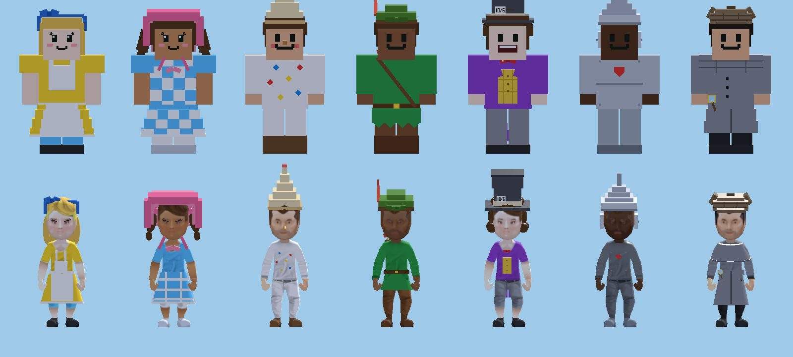
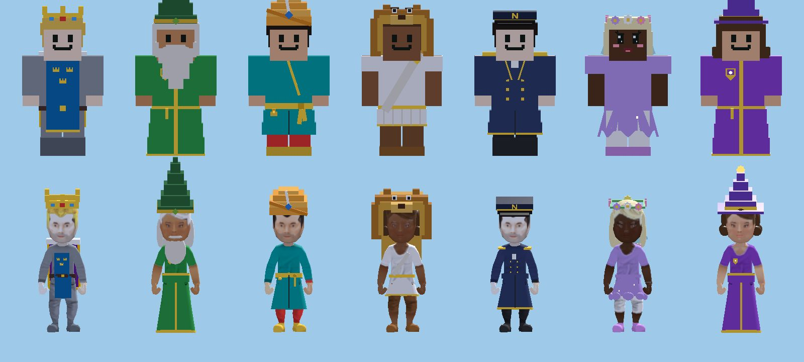
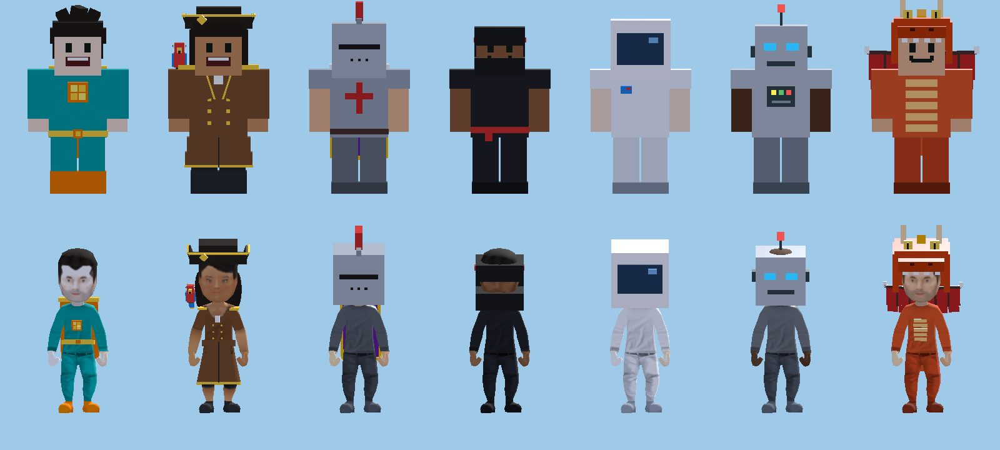
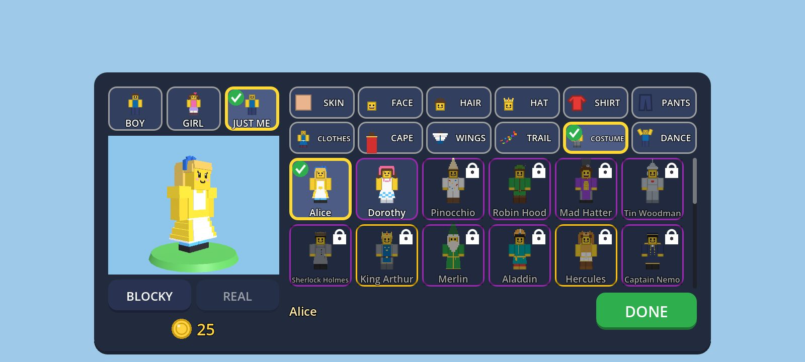

# Owner feedback #36: the Storybook costume pack (2026-09-25)

The owner (2026-09-24): "please also ipmpelment charachters from different movies, tc shows, marvell, harry potter and
any famous for children personas". **The lead's ruling #36:** film, TV and comic characters are owned (Disney, Warner
Bros, Marvel/DC); instead, public-domain storybook heroes drawn our own way **from the books** and our own genre
costumes. Brief `docs/superpowers/briefs/prompt-own36.md`; spec **§14.6b** (new), plan M3 **Task 27**. Built in a
worktree from `m2-survive-the-night` after `git merge lead-merge` (owner #48's girl avatars, the CLOTHES tab, quests,
M3 Task 8's building tools), without the editor or the emulator. The lead checks it on the emulator: see the list at
the end.

*Made by `tools/costume_shots.gd` (see DEVELOPMENT.md), each costume on a different skin tone (a costume keeps the
child's own). More in `owner-36/` (a `.gdignore` folder): the first row from the back (`owner-36-costumes-1-back.jpg`),
the faces close up (`owner-36-faces-close.jpg`: Pinocchio's nose and Merlin's beard on both heads), the editor opened
with two costumes already earned (`owner-36-editor-opened.jpg`), the COSTUME tab (`owner-36-editor-costume-alice.jpg`)
and Dorothy in REAL (`owner-36-editor-costume-dorothy-real.jpg`).*

## What was built

| Part | Where |
|---|---|
| **The pack** (`CostumeRules`): 21 costumes, each a whole look of catalogue parts (never the skin tone, the first choice or the dance wheel); their order in the tab; their sources (the legal check below); `wear`, `parts`, `is_complete`, `gives`, `way`, `met`, `sync`, `line`, `boss_event`. | `core/avatar/costume_rules.gd` (new) |
| **Costumes are avatar items** `"costume.<id>"` (`AvatarCatalog.COSTUME`, not a tab), each with one fixed earn way (kind BOSS, ACHIEVEMENT, SECRET or CODE). Their **own new parts** are items of the new kind `IN_COSTUME` ("costume": its id): 12 hats, 2 faces, 13 CLOTHES cuts, 2 back pieces, 3 trails, 2 outfits; once earned they mix with anything in their own tabs. **Earning a costume gives everything it wears** (`AvatarUnlocks.is_owned` also asks `CostumeRules.gives`), gold items in it too (the Knight's outfit and royal cape). | `core/avatar/avatar_catalog.gd` (section lines in `UNLOCK_KINDS`, `EARN_REASONS`, `ITEMS`, the cut shoes, `CUTS`, `OUTFITS`, `BOSS_EARNS`; `is_item` knows the costume slot; `rarity` of a part is its costume's), `avatar_unlocks.gd` (`is_owned`, `lock_reason`) |
| **Ways read from the profile**, named `"<kind>/<detail>"`: `level/N`, `title/<style>`, `quest/<chain>`, `badge/<id>`, `count/<kind>`, `secret/<kind>`, and M3 Task 9's `EARN_SECRET_PAGE` (a whole Secret Book page: now wired, so the **Fairy Wings** are finally earned too). `CostumeRules.sync(profile)` gives whatever is due; fixed and idempotent. | `costume_rules.gd` |
| **In a world:** on `Progress.changed`, at most every 0.5 s, only for the profile's own progress (never a test's), `sync` gives it with a toast "New costume: Dorothy! Try it on in the avatar editor."; a guest saves at once, the host with its world. | `autoloads/session.gd` (section `# --- Owner #36: costumes`, one line in `_ready`) |
| **Bosses:** the Golem's win now says what it gave (the Rock Helmet, and King Arthur) through `boss_apply_earn`; `BossDirector._earn_boss_items` asks `CostumeRules.boss_event(kind)`: the Sand Serpent earns Hercules, the Cake Monster keeps its cosmic outfit. | `session.gd` (`_boss_earn_avatar_item`, one line), `world/boss_director.gd` (3 lines) |
| **The code:** a cosmetic reward of `"costume.cube_hero"` in both code tables (the game gives cosmetics; the server only records the code). | `core/codes/code_rules.gd`, `server/modules/src/rules/code_rules.ts` (one line each) |
| **The editor:** the OUTFIT tab is now **COSTUME**: the 21 costumes first (124 px tiles, the child's skin tone, padlocks, rarity rims, never a price or a wish heart), then the outfits. One tap puts on the whole costume (`pick_costume`); a locked one is tried on and says "Alice: Reach level 3 to get it!"; DONE keeps only what is owned. Opening the editor runs `sync` and says "New costumes: Alice and Dorothy! Tap COSTUME to try them on." (old profiles get what they already earned). | `ui/avatar/avatar_editor.gd` (tab word, 3 hook lines, section at the end), `avatar_icon.gd` (`COSTUME` pictures) |
| **Both bodies:** 74 new part recipes: blocky boxes, and `_real` recipes in metres on the realistic chest and hips (cones, tubes and balls like owner #48's skirts). Hats sit lower on the realistic head (a part's `"real_offset"`); a painted realistic face wears a `face_<id>_real` add-on (Pinocchio's nose, Merlin's beard); a back piece may have a `_real` recipe. Outfits may have long sleeves (`"sleeves"`: the Tin Woodman's tin arms). 3 trail styles. | `entities/player/avatar_parts.gd` (section at the end of `PARTS`, `REAL_HAT_DROP`, `real_offset`), `avatar_model.gd` (3 lines), `core/avatar/avatar_look.gd` (2 lines), `avatar_trail.gd` (3 lines) |
| **Pictures without the emulator** | `tools/costume_shots.gd`, `_steps.gd` |
| **Georgian** (after merging M3 Task 21a): 84 lines appended to `i18n/ka.po` (**native check needed**: the costume and part names, the ways, the messages); formatted lines translated before they are filled in (`CostumeRules.line` through `Lang.t`, the editor's and Session's messages through `tr`); `SOURCES` (the legal-check data, never shown) in `i18n/not_words.txt`. `tools/i18n/words.gd -- --missing`: MISSING 0. | `i18n/ka.po`, `i18n/not_words.txt`, `costume_rules.gd`, `avatar_editor.gd`, `session.gd` |

### The costumes, their parts and their ways

| Costume | Its look (new parts in bold) | Earned by (fixed) |
|---|---|---|
| Alice | long blond hair, Sweet face, **Alice Band**, **Pinafore** (Tenniel's yellow dress, white pinafore), blue stockings | reaching **level 3** |
| Dorothy | brown pigtails, Sweet face, pink **Sunbonnet**, **Gingham Dress** (blue and white checks), **silver shoes** | Tilly's story **A home for animals** (a dog for Toto) |
| Pinocchio | **Long Nose** (and red cheeks), **Puppet Cap** (bread), **Paper Suit** (flowered paper, bark shoes) | Tilly's story **Tilly's lost map** (buried treasure: the Field of Miracles) |
| Robin Hood | **Feather Cap**, **Archer Tunic** (Lincoln green, belt, strap, **quiver**), boots | the **Explorer** title (10 new places) |
| Mad Hatter | curly hair, Grin, **Hatter's Hat** with the "10/6" card, **Tailcoat** (waistcoat, big bow tie, tails) | reaching **level 6** |
| Tin Woodman | the **Tin Woodman** outfit: funnel hat, tin all over (metal on the realistic person), the Wizard's red **heart** | the **Animal Friend** title (2 tamed animals: the kindest of them) |
| Sherlock Holmes | **Deerstalker**, **Detective Coat** (Inverness shoulder cape, **magnifying glass**) | the **Secret Hunter** title (2 secrets) |
| King Arthur | Crown, **Royal Tabard** (three gold crowns on blue over chainmail), Royal Cape | the **Stone Golem** (the sword in the stone) |
| Merlin | long white hair, **Wizard Beard**, **Merlin's Hat** (forest green), **Wizard Robe** in green | the **Buddy Maker** title (3 buddies woken) |
| Aladdin | **Turban** (saffron, a jewel), **Kaftan** (gold sash, **the lamp**), red trousers, golden slippers | Zara's story **The golden scarab** (the treasure cave) |
| Hercules | **Lion Hood** (the Nemean lion), **Greek Tunic** (gold belt, sandals) | the **Sand Serpent** (baby Heracles and the serpents) |
| Captain Nemo | **Nautilus Cap** (the golden N of the Nautilus' flag), **Captain Coat** in navy | finding a **sunken chest** (the treasure of Vigo Bay) |
| Fairy | long platinum hair, Lovely face, Flower Crown, **Petal Dress** in lilac, Fairy Wings, Sparkles | a **whole Secret Book page** (with the Fairy Wings) |
| Little Wizard | **Wizard Hat** (purple, a star), **Wizard Robe** in purple with our own crest, Sparkles | Tilly's story **Catch a falling star** |
| Cube Hero | **Hero Suit** (teal, a golden-block emblem, orange boots), **Cube Cape** | the **secret code** `cubehero2026` |
| Pirate Captain | **Tricorn** (gold trim), **Captain Coat** in brown, **Parrot Pal** on the shoulder | finding a **pirate cove** |
| Knight | Task 9's knight outfit and the Royal Cape | Zara's story **Safe desert paths** |
| Ninja | Task 9's ninja outfit, **Smoke Puffs** trail | the **Monster Buster** title (5 monsters) |
| Astronaut | Task 9's astronaut outfit, **Rocket** trail | reaching **level 10** |
| Robot | Task 9's robot outfit, **Sparks** trail | the **1,000 blocks** badge |
| Dragon Suit | the **Dragon** outfit (red hood with horns, spikes, tail, belly plates), Dragon Wings | **flying on a buddy** you built |

Every way is in the free game (Green Meadows, the Sandstorm Desert, the Sandbox, levels, a code): nothing is behind a
universe a grown-up buys.

## Patterns (GodotPrompter `resource-pattern`, `godot-ui`, `godot-testing`)

- **Chosen:** const tables in a pure class (`CostumeRules`), like `AvatarCatalog`, `QuestRules` and `BoardRules`: the
  costumes are fixed data tested as data; costumes are ordinary avatar items so the existing machinery (grant, earn,
  lock reasons, rarity, codes, the saved `cosmetics` list, the server backup) works unchanged. Costume tiles are the
  same `AvatarTile`s in the same grid as the outfits (like owner #48's ready looks).
- **Rejected:** `.tres` Resources per costume (no editor use here; a Resource file per costume would be read by
  nothing but code); a new profile field of earned costumes (derived from progress instead, so old profiles need no
  migration and a lost grant heals itself); a 13th editor tab (a third row does not fit 720 px) or a `TabContainer`
  (M2 Task 6's gotcha); making costumes OUTFITS (fixed colours, and they would hide the girl hair and cuts the lead
  asked to reuse); hooks in every system that finishes a way (quests, levels, titles, secrets): one `sync` on
  `Progress.changed` reads the profile instead.

## Tests (RED → GREEN)

New: `tests/unit/test_costumes.gd` (21), `tests/integration/test_costume_models.gd` (6),
`tests/integration/test_costume_editor.gd` (6), `tests/integration/test_costume_session.gd` (5). Changed:
`test_girl_avatars.gd` (the CLOTHES tab: owner #48's cuts stay free, the pack's cuts come with their costume),
`test_avatar_unlocks.gd` (a costume's name may be 15 letters, "Sherlock Holmes"; the editor test measures that every
costume's name fits its tile).

- **RED first:** the four scripts were written against an API stub (`CostumeRules` with empty tables and constant
  answers, three constants), so they parsed and failed on their assertions: 22 failing, 7 passing vacuously (empty
  lists) — "alice is in the pack", "the pack's own new parts: 0 expected to be >= 20", "Expected [] to contain
  wings.fairy", the editor's tiles `null`. GREEN after the catalogue, the parts, the rules and the glue.
- **Real faults the tests and pictures found on the way:** the banned-names scan hit "Dumbledore" in the username
  filter's list of innocent words (never shown: that file is exempt, with its reason); `UNLOCK_KINDS` lacked the new
  kind (Task 9's "every item has a known unlock kind" failed for all 33 parts); in the pictures, hats floated over
  the realistic head (`real_offset`), the Nautilus' N and the Hatter's 10/6 read backwards (the avatar's +X is the
  viewer's left), the realistic nose sat too low, and the realistic turban (a "cover" part) was twice too big.
- **Speed:** `CostumeRules.sync` takes 90 µs on this desktop and the COSTUME tab's 21 checks 127 µs (a scratch
  benchmark, not committed); on a phone (3–5× slower) that is under 0.5 ms, so the world's check runs at most every
  0.5 s, not on every counted block.
- **Server:** `npm test` in `server/modules` (the Cube Hero's code line): 231/231.
- **Full suite** (`tests/run_tests.sh`, after merging `lead-merge` `151541d`: #39's portals and the Dragon Realm, #41's
  animals, #45b, Nell, M3 Task 21a's Georgian): **550 scripts, 5,271 tests, 5,269 passing, 0 failing**, 2 risky (the
  generator's existing "did not assert" tests), exit 0, no `SCRIPT ERROR` / `Parse Error`, 935 s. A run on the
  earlier `lead-merge` (`a46b97f`) had 3 failures, all the lead's merge seams (#41's animal checks meeting #39's pet
  dragon, the keepsakes page 704 px tall), fixed on `lead-merge` by `1e1d6d6` and `efd53e4` and passing after merging them.
- **Commits:** `ba3210a` (the pack), `d7f1146` and `0ed00c2` (merges of `lead-merge`; Task 26 was taken twice there, so
  this is M3 Task 27), `4ec742c` (the final pictures), `de0b625` (merge of M3 Task 21a), `033a075` (Georgian).

## Rulings (decisions made on the owner's behalf; each is one table line or constant)

1. **A costume is a whole look of catalogue parts, and an avatar item of its own.** Earning it gives everything it
   wears; its new parts come only with it and then mix anywhere. *Cost if wrong:* if the owner wants costumes as
   untouchable outfits, `pick_costume` still works; the parts would move to `OUTFITS`.
2. **The OUTFIT tab is renamed COSTUME and shows the costumes first.** No new tab (12 tabs fill two rows), no new
   HUD button. *Cost if wrong:* one word in `TAB_WORDS`.
3. **Every costume is earned by playing, in one fixed way, all in the free game**; never gold, never a grown-up's
   pack (the shop tests and mine keep every costume and part out of every product; spec §18.4 updated: the
   "Storybook Pack" slot is gone). The Frost Giant, the Cake Monster and the paid universes' quests give no
   costume. *Cost if wrong:* if the owner wants a sold Storybook Pack after all, the sold items must be new ones
   (nothing earnable is ever sold, §18.1).
4. **The ways** (the table above): easy ones first (level 3, the first titles, Tilly's first stories), bosses and
   finds later, the Fairy and the Astronaut last. Girls' and boys' heroes are spread evenly (Alice at level 3,
   Dorothy in Tilly's second story, Pinocchio in her first). *Cost if wrong:* one `ITEMS` line each.
5. **Ways read from the profile are given when they happen, and when the editor opens** (so a child who finished
   Tilly's stories before this update gets Pinocchio and Dorothy at once). *Cost if wrong:* none known.
6. **Earning a costume also gives the gold items in it** (the Knight's outfit is 800 gold, the Royal Cape 400; they
   stay for sale too). *Cost if wrong:* a child gets them for free once; balance only.
7. **The Tin Woodman, not the Tin Man; silver shoes, never ruby slippers; Alice in Tenniel's yellow, not blue; the
   Hatter's hair brown, his hat grey; the fairy in lilac, not green; Merlin in forest green without stars (not
   blue with stars and moons, not grey with a brim); the wizard school purple with our own crest and no scarf or
   houses; our hero's emblem a golden block in teal and orange; our pirate without a feather, a hook or a skull.**
   *Cost if wrong:* colours are one line each.
8. **Names:** the books' names ("Sherlock Holmes", "Captain Nemo", "Tin Woodman", "Aladdin", "Hercules",
   "Pinocchio"); our own for our own ("Cube Hero", never "superhero": DC and Marvel jointly hold that mark). *Cost if
   wrong:* one `ITEMS` name each (the legal check below lists the ones to look at).
9. **A banned-names test** scans every string literal of the shipped code (not comments, tests, docs or tools) for
   65 film, TV, comic, game and toy names as whole words. *Cost if wrong:* a false alarm on a new legit word; the
   list is in the test.
10. **Never a boy's or a girl's:** every costume for everyone; wearing one keeps the first choice (BOY/GIRL stays a
    starting point). *Cost if wrong:* none (the lead's rule).
11. **The Secret Book page way is wired now** (Task 9's `EARN_SECRET_PAGE` was never called): a whole page of either
    book (the eight secrets, or the twelve treasures) gives the Fairy Wings and the Fairy. *Cost if wrong:* the wings
    come to children who complete a page (as Task 9 intended).
12. **Toasts:** a costume says "New costume: …"; other new items say Task 4's "You got a new look: …"; the Golem's
    win now says what it gave (the Rock Helmet was silent). *Cost if wrong:* words only.
13. **In Georgian the heroes get their Georgian book names** (ალისა, პინოქიო, შერლოკ ჰოლმსი, კაპიტანი ნემო, მეფე
    არტური), unlike Task 21a's rule for bots' and pets' names: these are the books' characters, which Georgian
    children know by those names. The Tin Woodman is თუნუქის მეშეშე (the book's woodcutter), the Mad Hatter შლეგი
    მექუდე. *Cost if wrong:* one `ka.po` line each (a native speaker should check them all).

## Legal check (suggested for the owner's lawyer before release)

Everything below is drawn our own way from boxes; no film, TV or company design, name or logo is copied. Public
domain means: in the US, published in 1930 or before (as of 2026); in the EU and UK, every maker died more than 70
years ago (before 1956).

| Costume | Source work and date | Why it is safe | Look at |
|---|---|---|---|
| Alice | Lewis Carroll, *Alice's Adventures in Wonderland* (1865; Carroll d. 1898); John Tenniel's drawings (1865, coloured in *The Nursery Alice*, 1890; d. 1914) | the book and drawings are public domain everywhere; our Alice is yellow with a white pinafore and a blue band, not the 1951 film's blue dress and black bow | — |
| Mad Hatter | the same book; Tenniel's hat with its "10/6" card | public domain; no green hat, no orange hair (the films') | — |
| Dorothy | L. Frank Baum, *The Wonderful Wizard of Oz* (1900; d. 1919); W. W. Denslow (d. 1915): "checks of white and blue", the pink sunbonnet, the Silver Shoes | public domain everywhere; **silver** shoes and a sunbonnet are the book's; the 1939 film's ruby slippers and costume are Warner's and are not used | the name "Dorothy" + "Oz" marks: we never say "Oz" |
| Tin Woodman | the same book; Denslow's funnel hat | public domain; the book's name ("Tin Woodman"), not the film's | — |
| Pinocchio | Carlo Collodi, *Le avventure di Pinocchio* (1883; d. 1890); Enrico Mazzanti's drawings (d. 1910): the cap of bread, the flowered paper suit, the bark shoes, the nose | public domain; not Disney's (no Tyrolean hat with a feather, no shorts and braces, no bow tie) | "Pinocchio" as a word mark in some classes |
| Robin Hood | the ballads (15th century); Howard Pyle, *The Merry Adventures of Robin Hood* (1883; d. 1911) | a legend with no owner; our cap and tunic follow Pyle | — |
| King Arthur, Merlin | Geoffrey of Monmouth (c. 1136), Thomas Malory (1485); Pyle's Arthur books (1903–1910); Arthur's arms (three gold crowns on blue) are medieval heraldry | legends with no owner; Merlin is green without stars (not Disney's blue, not a star-and-moon hat, not a grey hat with a brim) | — |
| Sherlock Holmes | Arthur Conan Doyle's stories (1887–1927; d. 1930, so EU/UK public domain since 2001; every story public domain in the US since 2023); Sidney Paget's deerstalker and cape (1891; d. 1908) | the character and the Paget look are public domain; no film or TV look (no BBC coat and scarf) | **"Sherlock Holmes" is registered as a trade mark by the Conan Doyle Estate in some classes** — ask whether the name may label a costume; if not, rename to "Detective" (one line) |
| Aladdin | *Aladdin and the Wonderful Lamp*, added to *One Thousand and One Nights* by Antoine Galland (1712; d. 1715) | public domain; not Disney's (no purple vest, bare chest, fez, monkey or carpet) | "Aladdin" as a Disney word mark in some classes |
| Hercules | Greek myth (Heracles and the Nemean lion: Hesiod, c. 700 BC) | myth has no owner; the lion-skin hood is the classical sign; not Disney's (no blue cape, no brown armour) | "Hercules" as a word mark (Disney, Marvel) in some classes |
| Captain Nemo | Jules Verne, *Vingt mille lieues sous les mers* (1870; d. 1905); Alphonse de Neuville's drawings (d. 1885); the Nautilus' flag, "a golden N" | public domain; nothing of the 1954 film or of Pixar's fish | "Nemo" near "Finding Nemo" (we never say "Finding") |
| Pirate Captain | our own; the shoulder parrot is Long John Silver's (*Treasure Island*, 1883; Stevenson d. 1894) | a genre costume; no red coat with a feathered hat (Captain Hook), no bandana and braids (a film pirate) | — |
| Little Wizard | our own | a genre costume: purple with our own crest; no black robe, house colours, scarf, crest or school name of Hogwarts | — |
| Cube Hero | our own | a genre costume: our own golden-block emblem in teal and orange; no S, bat, spider, star-on-blue, lightning or any Marvel/DC scheme; never called "superhero" (a DC/Marvel joint mark) | — |
| Fairy | our own | lilac petals and flower crown, not a green dress with a bun (Tinker Bell); Peter Pan's UK right is avoided | — |
| Knight, Ninja, Astronaut, Robot | our own (M3 Task 9's outfits) | genre costumes | — |
| Dragon Suit | our own | a red dragon hood with horns; nothing of a film's dragon (no black dragon with green eyes) | — |

Avoided on purpose, even if old: Peter Pan (a perpetual UK right), Winnie-the-Pooh (EU copyright to 2027), and every
film's or company's look, name or logo.

## For the lead

**Merge notes.** Shared files, each a marked section or a few lines: `core/avatar/avatar_catalog.gd` (`IN_COSTUME`
and `COSTUME`, `EARN_SERPENT`, lines at the end of `EARN_REASONS`, `ITEMS`, `CUTS`, `OUTFITS`, the cut shoes,
`BOSS_EARNS`, `is_item`, `rarity`), `avatar_unlocks.gd` (`is_owned`, `lock_reason`), `avatar_look.gd` (outfit sleeves),
`entities/player/avatar_parts.gd` (section at the end of `PARTS`, `REAL_HAT_DROP`, `real_offset`), `avatar_model.gd`
(the realistic face add-on, capes through `_part_id`, `real_offset`), `avatar_trail.gd` (3 styles),
`ui/avatar/avatar_editor.gd` (the tab word, 3 hooks, a section at the end), `avatar_icon.gd`, `autoloads/session.gd`
(`_costumes_ready()` in `_ready`, `_boss_earn_avatar_item`, the section at the end), `world/boss_director.gd`
(`_earn_boss_items`), `core/codes/code_rules.gd` and `server/modules/src/rules/code_rules.ts` (one line each: the
server module needs a redeploy for the Cube Hero's code to work when signed in; offline it works now). A boss's avatar
items go in `AvatarCatalog.BOSS_EARNS` (owner #39's Sky Dragon keeps its own gifts: `Session.boss_give_dragon`, next
to it in `_earn_boss_items`, as merged). Task 26 was taken twice at the merge: this is M3 Task 27.

**Check on the emulator:**
1. Main menu → AVATAR → COSTUME: 21 costume tiles first (the figures readable at phone size, padlocks), then the
   outfits; the panel still fits 20:9 and 16:9 with DONE visible; "Sherlock Holmes" fits its tile.
2. Tap a locked costume (Dorothy): the preview wears it at once, the line says how to earn it, no BUY and no WISH;
   DONE takes off the parts not owned.
3. A profile at level 3 (about 25 minutes of play): opening the editor says "New costume: Alice! …"; Alice is one tap
   and stays after DONE; in a world the player wears her in both styles (Settings → style).
4. REAL: every costume (compare `owner-36/*.jpg`): hats sit on the head (not floating, not sunk), Pinocchio's nose
   and Merlin's beard on the painted face, skirts and coats follow the hips when running (legs may show through a
   coat mid-stride, as with owner #48's skirts), the Tin Woodman metallic, Dorothy's shoes silver
   (Compatibility's `force_srgb` path).
5. In a Survivor world: finish Tilly's first story → "New costume: Pinocchio! …" within half a second; beat the
   Golem → "You got a new look: Rock Helmet!" and "…: King Arthur!"; beat the Sand Serpent → Hercules.
6. Secret code `cubehero2026` in the admin panel: "Code accepted! New: Cube Hero" (signed in: after the server
   module is redeployed).
7. LAN: the other player's costume shows in each game's style (the look code carries it; nothing new is sent).
8. Performance: the autopilot in REAL wearing the Pirate Captain (a coat, a parrot) and the Fairy (petals, wings,
   trail): no frame over 100 ms when a costume first appears (the same two part materials as every part).
