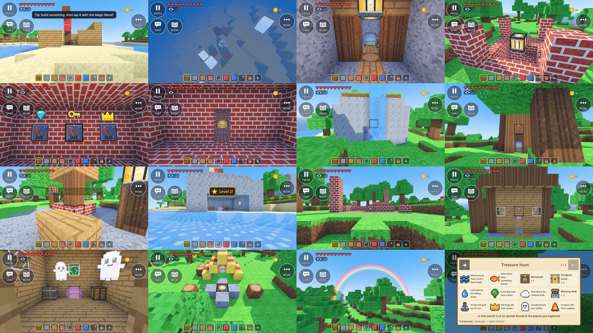

# Owner feedback #42: more secrets, chests and treasures (notes)

Owner, 2026-09-24 20:43: "also please create more secrets in the game" + "more chests and treasures".
Brief `docs/superpowers/briefs/prompt-own42.md`; spec §12.16b (new), plan M3 Task 22 (new). Built by a
background agent in its own worktree (branch cut from `m2-survive-the-night` at `0ae1f98`), without the editor
or the emulator. **`lead-merge` (M3 Task 3, Frostpeak, `ec8c65c`) was merged into this branch first**, as the
lead's update said Frostpeak is merged and is the pattern for universe-specific secrets (ruling 1).

*Left to right, top to bottom: a shipwreck on the beach; a sunken chest (rare, blue glow) on the seabed; a
mineshaft's tunnel with plank rails, a beam's lantern and the loot cart; a vault's lantern pillar; the vault's
levers with the gem, key and crown; the open golden door and the legendary chest; a waterfall over a cave (epic,
purple); a hollow tree; a wishing well's plaza; a pirate cove from the sea; ruins; a haunted house; its two
friendly ghosts and the epic chest; a campsite; a rainbow across the view; the Secret Book's "Treasure Hunt" page
with picture riddles.*

## What was built

| Piece | Where | What it does |
|---|---|---|
| Places (pure) | `world/generators/treasure_places.gd` (`TreasurePlaces`) | The 11 placed kinds, built as SecretRules secrets in each universe's own blocks (a palette per style: Green Meadows, the desert's sandstone and palm, Frostpeak's snow brick and pine). SecretRules asks for them **after** its own M2 attempts (`SecretRules.more`), so every generator writes them (boxes, clipped per chunk) and the M2 secrets and their saved ids never move. Heights are memoised per build (never shared: thread-safe). |
| SecretRules hooks | `world/generators/secret_rules.gd` | `more` (null with `SecretRules.new(seed, shape, false)`), the pack's attempts appended in `_place`, `_build`'s fallback, `is_kind`, `nearest_buried(..., kinds)` |
| Rules (pure) | `core/rules/treasure_rules.gd` (`TreasureRules`) | The pack's names, find lines, pictures, the Secret Book's picture riddles, explorer bots' lines, /secret names; the rainbow's timing, spot (across the view) and pot; the well's once-a-day and its gifts; the vault's lever states; the ghosts' riddles; lock texts; which pets sniff and which chests they lead to |
| Chest rarities (pure) | `core/rules/treasure_loot.gd` (`TreasureLoot`); `LootRules.roll` hands the pack's chests to it | common / rare / epic / legendary, fixed gold 15 / 40 / 80 / 150 × 2^(u−1), 2 picks without repeats from the rarity's table (shared + the universe's own), epic always 4 gold ore, legendary always a golden trophy |
| Save | `core/save/treasure_state.gd` (`TreasureState`, inside `SecretState.more`) | dawns seen (the well's day, the rainbows' schedule), rainbows so far, pots taken ("n:player"), each player's last wish day; cleaned on load, capped at 512 |
| Host logic | `world/treasure_director.gd` (`TreasureDirector`, the SecretDirector's child `Treasures` on every peer) | the pack's things near players (ghosts, a well's tap box, the pictures over a vault's levers), the vault's levers at 10 Hz, ghosts' answers, wishes, days and rainbows, pots; RPCs for the coin, giggles, the rainbow's chime |
| SecretDirector hooks | `world/secret_director.gd` (small, marked "owner 42") | creates `Treasures`; its host tick, plate tick, spawn and make-thing call it; things that `stays` (rainbow, pot) are not despawned by distance; lock texts by kind; kind-specific bot lines; pets sniff every unlocked chest; the pack's find lines and pictures; `/secret` names, spots (`visit`) and `/secret rainbow`; banners name the pack's rarity ("Epic treasure! …") |
| Things | `entities/interactables/friendly_ghost.gd`, `wishing_well.gd`, `pot_of_gold.gd`, `rainbow_arch.gd`, `lever_marks.gd`, `treasure_models.gd` | a floating, giggling, camera-facing ghost with a picture riddle; a well's tap box and bucket; a glowing pot of gold; a six-band see-through rainbow arch (one shared mesh and material, fades in with `GeometryInstance3D.transparency`); key/crown/gem signs over the levers; a loot cart's wheels (`TreasureModels.dress`). Every mesh and material is shared (built once). |
| Taps | `entities/interactables/secret_taps.gd` (+2 lines) | a thing with `use_tap(hud)` handles its own tap (ghost: the riddle; well: a wish) |
| Session | `autoloads/session.gd`, section "Owner 42: more secrets" | `request_wish` → `secret_wish_requested` (host-checked by the director) |
| Secret Book | `ui/hud/secret_book.gd`, `ui/hud/hud.gd` (+1 line) | a second page, "Treasure Hunt": a slot per kind of the pack, a picture riddle until found; ◀ ▶ page buttons (90 px) in the title row; opens on page 1; page 1's title names the universe. The open book and a riddle now block taps from building behind them (see ruling 17). |
| Pictures | `data/secrets/treasure_pictures.png` (8 × 3, `tools/make_treasure_pictures.gd`), `ui/hud/pictures.gd` | 22 pictures with ids 32+ in their own atlas (the M2 atlas is untouched) |
| Sounds | `tools/make_treasure_sfx.py` → `giggle.wav`, `coin_toss.wav`, `rainbow.wav`; `autoloads/audio.gd` | original procedural |
| Words | `core/rules/riddles.gd` | six hidden-room / ruins notes hint at the new kinds; `Riddles.word` knows the new pictures |
| Pets | `entities/animal/animal.gd` (one line) | dogs, and any `*fox` or `*parrot` (owner #41), sniff out treasure |
| Chat | `core/rules/chat_commands.gd` | `/secret` knows the pack's kinds and `rainbow` |
| Profile | `core/save/profile_data.gd` (two lines) | the Secret Book counts the pack's kinds account-wide |
| Tools | `tools/treasure_smoke.gd` (+ steps), `tools/treasure_shots.gd` (+ steps) | headless end-to-end run (38 checks) and windowed screenshots |

### The kinds

| Kind | Where | Structure | Chest | Found when |
|---|---|---|---|---|
| Shipwreck | Meadows: a beach (ground at sea level, water within 16 blocks towards the bow); desert: open, gentle sand | a broken plank ship on a sand mound, mast and yard, a torn sail, a hole in its side, barrels | rare | standing in the hull, or opening it |
| Sunken chest | Meadows: the seabed 4–12 under water, 30 blocks round | broken planks and a barrel on the seabed | rare | next to it (swimming), or opening it |
| Mineshaft | all three | a timber frame, 6 plank steps down, a 14-block tunnel with plank rails on log sleepers, posts and beams with lanterns | rare (a loot cart on wheels) | in the tunnel |
| Dungeon vault | all three | a lantern on a pillar and corner posts; a 19-step spiral stair 20 down; a hall with three levers (key, crown, gem signs) and a note of their order; the golden door; the vault room | legendary, locked until solved | the levers solved, or entering the vault room |
| Waterfall cave | Meadows | a mossy rock (built: the meadows have no cliffs), a stream on top pouring over the mouth into a shallow pool, crystals in the cave | epic | in the cave |
| Hollow tree | Meadows, Frostpeak (a pine) | a 5 × 5 rounded trunk, a doorway into a 3 × 3 hollow, a crown of leaves (a cone of needles) | rare | in the hollow |
| Wishing well | Meadows, desert | a round cobbled plaza, a well (rim, water, posts, roof, bucket), two lamp posts, two benches | none: a gift | a wish, or the plaza |
| Pirate cove | Meadows: a beach | a rock dome at the waterline, sand floor, a lagoon by its mouth (facing the water), barrels, lanterns, a flag | epic | inside |
| Ancient ruins | all three | a broken floor with grass in the cracks, pillars of 1–5, a fallen pillar, wall stubs, an old riddle note | common | inside |
| Haunted house | Meadows, Frostpeak | an old plank house on a stone foundation, log corners, a gabled log roof, glass and a broken window, a closet and a barrel, two friendly ghosts | epic, locked until a ghost's riddle is answered | inside, or the right answer |
| Campsite | all three | a striped tent (red/yellow; Frostpeak blue/yellow), a campfire in a stone ring, log seats, a woodpile | common (supplies) | at the camp |
| Rainbow's end | everywhere, while playing | a see-through arch across the view, a glowing pot of gold at its foot, 3 minutes | 50 gold × 2^(u−1) (Survivor) + 4 of each rainbow block, each player once per rainbow | reaching the pot |

Measured over 256 areas of seed 12345 (Green Meadows): 40 camps, 38 hollow trees, 33 ruins, 29 mineshafts, 27
sunken chests, 26 waterfalls, 21 vaults, 20 haunted houses, 19 wells, 14 coves, 10 shipwrecks — about 1.1 new
places per area on top of M2's ~1.9. The desert has all six of its kinds within ±5 areas, Frostpeak all six.

## Skills and patterns (godot-prompter)

- **procedural-generation:** seeded, per-area RNG (the M2 SecretRules draw order, the pack's attempts appended
  after it), placement checks against the terrain rules (not the voxels), and reachability by construction
  (open, walkable entrances; a test walks every door). Rejected: noise-driven scattering per column (would need
  its own seam handling) and cellular caves for the waterfall (the meadows have no cliffs: a built rock is
  deterministic and readable).
- **multiplayer-basics:** every find and reward is decided by the host (any_peer request → checked → authority
  RPCs for effects); things come through the director's MultiplayerSpawner; the new director is a fixed-name
  child ("Secrets/Treasures") so its RPCs line up. Rejected: a MultiplayerSynchronizer for ghosts' floating
  (animated from the clock on every peer, nothing to send).
- **godot-ui:** the Secret Book's pages are shown/hidden grids in one PanelContainer (not a TabContainer: the
  M2 gotcha about its internal HBox), big plain Buttons, labels that wrap for the riddles.

## Tests (RED → GREEN)

| File | Tests | RED (why it failed first) |
|---|---|---|
| `tests/unit/test_treasure_places.gd` | 26 | missing `TreasurePlaces` / `SecretRules.new`'s third argument; then 16/26: too few places (tree-free footprints passed ~9%, rises ≤ 1, beaches 6 blocks from deep water) — fixed with pads and gentler shore rules |
| `tests/unit/test_treasure_rules.gd` | 17 | missing `TreasureRules`; `/secret shipwreck` refused (error line); the arch ran away from the view (orientation assert added with the fix) |
| `tests/unit/test_treasure_loot.gd` | 11 | missing `TreasureLoot`; M2 gold random |
| `tests/unit/test_treasure_state.gd` | 5 | missing `TreasureState` |
| `tests/unit/test_treasure_pictures.gd` | 4 | written with the atlas (checks it is drawn, different, picked, and the sounds registered) |
| `tests/integration/test_treasures_in_world.gd` | 14 | missing director; then the camp's book count (the test read "before" after the find — test fixed) |
| `tests/integration/test_secret_book_pages.gd` | 6 | missing pages API; the open book did not block taps |
| M2 tests adjusted | | `test_secret_rules` (attempts include the pack's), the three generators' seam tests (count the M2 kinds; the pack's are seam-checked too), `test_chat_commands` (/secret choices) |

Full suite (`tests/run_tests.sh`, exit 0, "All tests passed"): **341 scripts, 3276 tests** on this branch (83 of
them new).

## End to end in the real game (no editor, no emulator)

`tools/treasure_smoke.gd` (headless, new Sandbox world, seed 12345): **38 checks pass** — the camp's tent in the
generated terrain and its common chest; the vault's generated levers and golden door, three real lever taps
(M3 Task 7's SmartDirector) in the note's order opening it, the legendary chest and the golden trophy on the
shelf; the haunted house's ghosts and the riddle opening its chest; the well's water and a wish (one a day);
`/secret rainbow`, walking to the pot; the save (solved places, rainbows) and the Secret Book counts. No engine
errors in the log.

## Placement cost

`secrets_in_area` per new area (400 areas, desktop at load 42–48, other agents building): Green Meadows 0.43 ms
without the pack → **1.00 ms with it**; desert 0.99 ms, Frostpeak 1.37 ms; worst frames 8–15 ms (the same order
as without the pack under that load). Per build: 0.07–0.15 ms (a coast check skips the shore kinds inland). The
director places areas on the main thread when a player comes near (once per area); the treasure map's first
look (25 areas) is now ~25 ms on the desktop. Measure on the emulator; if needed, warm one area per frame.

## Rulings (decisions on the owner's behalf; cost if wrong)

1. **Merged `lead-merge` (Frostpeak) into this branch** to build Frostpeak's variants on the real FrostShape.
   *Cost:* none if Frostpeak lands as merged; otherwise drop Frostpeak's style from `TreasurePlaces`.
2. **No new block or item ids** (the brief allocates none): the places use existing blocks; the vault's levers
   are Task 7's LEVER; its door is YELLOW like the temple's. *Cost:* no dedicated "gold coin" item or rail block.
3. **The pack's attempts come after the M2 ones**; kind names have no "_". Worlds saved before keep every M2
   secret and id; new places appear in chunks that were never changed. *Cost:* a place crossing an edited
   chunk is cut there (ruling 24 of M2).
4. **"Never blocking paths"** = the world has no paths yet, so: never within 60 blocks of the world spawn (Tilly
   12, the Totem 20, the hub circle ≤ 11, the Theater 28–48 and 9 wide, and the ways between them), never on a
   river, every entrance open and walkable (tested for every place). *Cost:* when villages or roads come, add
   their check in `TreasurePlaces.build`.
5. **Trees are cleared by pads, not avoided** (as M2's temple does): 1.4 % of meadow columns are trunks, so a
   tree-free 13 × 13 passed 9 %. Pads fill dips and cut into slopes (rise ≤ 3–5). Frostpeak keeps its igloos
   whole. *Cost:* now and then a tree's leaves are cut at a pad's edge.
6. **Shores are gentle**: a shipwreck or cove needs a beach column (sea level to +2) with water (2 deep) within
   16 blocks in one direction; ships lie "washed up" on a sand mound. *Cost:* fewer ships (10 in 256 areas).
7. **Mineshafts and vaults try all four directions** for ground to cover their tunnel/hall.
8. **The vault**: a compact spiral stair under a lantern pillar; levers count only when flipped while a player
   is near (levers left on in a saved world don't); a wrong lever flips them all back (a lever that starts the
   order again stays on); the chest stays locked until solved, even if someone digs in. Lever taps are M3 Task
   7's (checked reach and rate); the director only watches the lever blocks. *Cost:* none known.
9. **The waterfall is a built mossy rock** (Green Meadows has no cliffs); the water hangs from the top down to
   one block over the pool, so a child wades under it into the cave without swimming up a column of water.
   *Cost:* a one-block gap at the bottom of the fall.
10. **The rainbow**: no rain exists yet, so it comes at the start of the day after the first dawn always, then
    about one dawn in two; `TreasureDirector.rain_ended()` is the weather hook (a rainbow by day). It arches
    across the player's view, its pot 16–28 blocks away on dry ground, for 3 minutes. **Each player takes the
    pot once per rainbow** (co-op: everyone gets theirs). *Cost:* at most 50 × 2^(u−1) gold per player every
    other in-game day.
11. **The wishing well's coin is free** (a pretend coin: nothing is paid); the gift is fixed by the day of the
    week (potions, a treasure map, lanterns, colour blocks, glass — never gold); once per in-game day (dawns seen,
    saved) for each player, keyed by their name. *Cost:* two players with the same name share one wish a day.
12. **Ghosts are not Wanderers** (the director would take one for the Wanderer); their answers go through
    `request_wanderer_answer` with names "ghost_…". Two ghosts per house; they stay after the right answer.
13. **Chest rarity is fixed per kind** (common: camp, ruins; rare: shipwreck, sunken, cart, hollow tree; epic:
    cove, waterfall, haunted; legendary: vault), the glow in its §13.2 colour.
14. **§6 — no random gold anywhere**: the M2 kinds' gold is now fixed (the middle of their old ranges: buried 40,
    room 65, temple 95, sky 125, Wanderer 45, golden animal 80), with their items unchanged (the RNG still draws
    the same numbers). *Cost:* M2 chests no longer vary in gold.
15. **Banners name the rarity** of the pack's chests ("Legendary treasure! …"); a wish and a pot have their own.
16. **Pets sniff every unlocked chest** (not sky islands: unreachable) and the species `dog`, any `*fox`, any
    `*parrot` (owner #41's names aren't known yet). *Cost:* rename in `TreasureRules.SNIFFERS` if #41 differs.
17. **The open Secret Book and riddle panel block taps** from building behind them (`look_area.blockers`): found
    while adding page buttons — a pre-existing M2 gap (`LookBuildArea` reads touches in `_input`).
18. **The pack's pictures live in their own atlas** (ids 32+), so the M2 PNG never changes (merge-safe).
19. **The Secret Book's page 1 title names the universe** ("Secret Book — Frostpeak"), page 2 is "Treasure Hunt".
20. **Desert and Frostpeak get six kinds each** (their land can't hold sea kinds; a desert haunted house or a
    frozen waterfall would need their own designs). *Cost:* add styles to `ATTEMPTS` / `KINDS_BY_STYLE`.

## Hooks and notes for the lead (merge)

- **Weather** (owner #40's /weather, or rain later): call `get_node("Secrets").treasures.rain_ended()` when rain
  stops.
- **Achievements / board goals** (M3 Task 12): finds already fire `secret_found/<kind>` (e.g.
  `secret_found/vault`, `secret_found/rainbow`); add goals if wanted.
- **Owner #41** (foxes, parrots): `TreasureRules.sniffs(species)`.
- **Candy Kingdom** (Task 4): `TreasurePlaces` falls back to Green Meadows' style for any other shape; add a
  palette and attempts for its own look.
- **Likely merge conflicts**: `world/secret_director.gd` (hooks), `world/generators/secret_rules.gd`,
  `autoloads/session.gd` (end section), `autoloads/audio.gd` (SOUNDS end), `core/rules/chat_commands.gd`
  (`SECRET_KINDS`, `/secret` usage — owner #40 edits commands too), `core/rules/riddles.gd` (ROOM_NOTES end),
  `core/rules/loot_rules.gd`, `entities/animal/animal.gd` (one line), `ui/hud/hud.gd` (one line),
  `ui/hud/secret_book.gd`, `assets/CREDITS.md`, `docs/DEVELOPMENT.md`, the spec (§12.16b) and the M3 plan (Task
  22); tests: the three generators' seam assertion, `test_secret_rules`, `test_chat_commands`.

## What to check on the emulator

1. `/secret camp` (then each kind: shipwreck, sunken, mineshaft, vault, waterfall, hollowtree, well, cove,
   ruins, haunted) and its `/tp`: each place in both styles; chests glow grey / blue / purple / gold.
2. The vault: the lantern pillar, down the spiral, the lever pictures upright; tap the levers in the note's
   order ("Click! 1 of 3" …), a wrong one ("Clunk!", they flip back), the golden door opens; the legendary chest.
3. The haunted house: the ghosts float, turn, giggle; tap one: its riddle with picture answers; the right one
   opens the chest; a wrong one: "Hee hee! Not quite. Try again!".
4. The well: tap it — a coin's plop and sparkle, a gift; again: "The well already gave you a gift today."
5. `/secret rainbow`: the arch across the view, fading in; the pot's golden glow; walk to it.
6. The Secret Book's second page: picture riddles, ◀ ▶, a found kind; a tap on the open book never builds.
7. A pet dog leading to a campsite or shipwreck chest; an explorer bot's "Look! An old ship!".
8. Frame times while walking into new areas (placement ~1 ms per area on the desktop) and near a rainbow (one
   big transparent mesh) in both styles.
