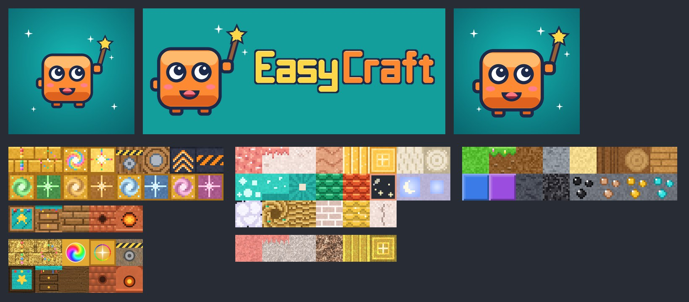
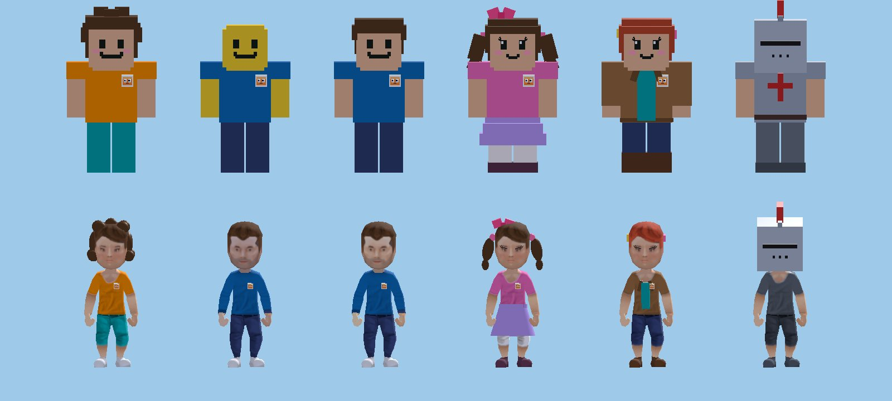

# Owner feedback #43: our own look (2026-09-25)

The owner (2026-09-24): "because our game is visualli similar to minecraft, will google play allow me to upload a
game? should we change a visuals to make it different?" Brief `docs/superpowers/briefs/prompt-own43.md` (part of M5
Task 2, run early), plus the coordinator's additions: judge #39's portals and Dragon Realm, keep saved avatars, the
EasyCraft boot splash. Spec §3c (new, written before the build), the M5 plan's identity line. The audit with every
verdict is `docs/design/identity-audit.md`. Built in a worktree from `lead-merge` at `f40eb97`, without the editor,
the emulator or godot-mcp; brought up to date with `lead-merge` before the final suite.

*Both pictures are in `owner-43/` (a `.gdignore` folder). The avatars were drawn in a window by a scratch script
like `tools/girl_avatar_shots.gd`; the tiles are the generated pages.*

## What was built

| Part | Where |
|---|---|
| **The brand**: the buddy mark (an orange block buddy with googly eyes holding the wand's star) on our teal `#139e9b` as the launcher icon (the buddy inside the adaptive-icon safe zone) and a bigger store icon; the **wordmark** "EasyCraft" in bubble-block letters from the script's own grid font; the **boot splash** (buddy and wordmark, 720 × 300, 11 KB, drawn at its own size on the teal splash colour). All our own drawing, no font file. | `tools/make_brand_art.py`, `icon.png`, `assets/brand/splash.png`, `assets/brand/wordmark.png`, `docs/store/graphics/next/icon-512.png` (`.gdignore`: not in the APK) |
| **Boot splash**: `application/boot_splash/image`, `bg_color` (teal), `stretch_mode` 0 (its own size, never stretched blurry). The PNG is imported **"keep"**: Godot stores the boot splash raw in the pack, so no second (imported) copy goes in. Every Android preset exports `all_resources` and none excludes `assets/`. | `project.godot`, `assets/brand/splash.png.import` |
| **The menu title** is the wordmark picture (492 × 120, the old title's place and bob). | `ui/menus/menu.gd` |
| **Portals, gold and rainbow** (never purple swirls in dark frames): page 10's frame (gold blocks with rainbow gems) and core (a rainbow swirl gem in gold) in both styles; the universe cores in a golden setting; the swirl shader's new `rainbow` uniform (the plain portal's arms run through the rainbow; sparkles are rainbow for all); `PortalSwirl` sets every material's colours; `CrystalRules.SWIRLS[0]` gold; the Dragon Realm's swirl coral and cream. | `tools/make_portal_page.gd` / `.py`, `shaders/portal_swirl.gdshader`, `entities/portal/portal_swirl.gd`, `core/rules/crystal_rules.gd` |
| **The Dragon Realm at sunrise**: page 11 recoloured (coral moss, pearl and apricot floatstone, golden spires, coral starglass frame, blush bricks), its sky a morning blue over a golden horizon, peach fog, a bright sea of clouds below. | `tools/make_dragon_atlas.gd`, `tools/make_dragon_realistic.py`, `world/universes/dragon.gd` |
| **Sun lanterns**: the Sky Dragon's healing towers are golden lanterns on cloud-white pillars with golden beams; "Break the sun lanterns — they heal the Sky Dragon!". | `entities/monsters/sky_dragon_models.gd`, `core/rules/sky_dragon_rules.gd` |
| **The Workbench and the Clay Oven** (same ids 220/221, same recipes): a teal mat with a star stamp and paint pots, drawers with brass knobs; terracotta tiles round a chimney, a clay dome with a round window of fire. Names, craft messages, a board goal and a quest step follow. | page 10 row 6 (both tools), `data/blocks/block_ids.gd`, `core/crafting/craft_rules.gd`, `core/progress/board_rules.gd`, `core/progress/quest_rules.gd` |
| **Page 0**: the grass side is a rounded cap with two little flowers over pebbly dirt; the ores are chunky round gems with a glint. Drawn last (`_identity_pass`, own RNG) over the old tiles. | `tools/make_atlas.gd` |
| **The slime** is a jelly drop (a stepped dome, a curl, a glossy spot, cheeks, a smile), not a cube. | `entities/monsters/monster_models.gd` |
| **The default avatar**: peach skin, curly brown hair, the rosy smile, an orange tee, teal trousers (new players, JUST ME). `AvatarLook.classic()` is the old default; saved profiles fill anything missing from it. The blocky head is rounder (three crossing boxes) and 8 % bigger; the **buddy badge** on every body's chest in both styles (a full outfit hides it). | `core/avatar/avatar_look.gd`, `core/save/profile_data.gd`, `entities/player/blocky_avatar.gd`, `entities/player/avatar_model.gd`, `entities/player/buddy_badge.gd` (new) |
| **Words**: a test scans the store drafts, release notes, public pages, the Georgian translations (`i18n/*.po`, M3 Task 21a), every game string and data file for other block games' names and creatures (English and Georgian). | `tests/unit/test_identity_words.gd` |
| **Georgian** (M3 Task 21a merged before the final suite): the 11 new or changed lines (Workbench სამუშაო მაგიდა, Clay Oven თიხის ღუმელი, the sun lanterns მზის ფარნები, the sun crystal geode, the craft messages and goals) appended to `i18n/ka.po`, **native check needed**; `tools/i18n/words.gd -- --missing` says MISSING 0. The old lines ("Crafting Table", "crystal towers", "amethyst geode") are left in the file, unused. | `i18n/ka.po` |
| **Store**: art direction (lead with the living buddies, Size Magic and the universes; never a plain grass-block landscape; no other game's name), the new graphics plan and screenshot order, the owner's **trademark search** for "EasyCraft" (registers, classes, steps). | `docs/store/listing.md` |
| **The toon look**: costed from code and measurements, left as a proposal with a build-and-measure plan. | `docs/design/identity-audit.md` §6 |

**Every changed page tile was checked tile by tile** against the page before (a scratch diff of all 64 tiles of
each file): page 10 pixel and albedo changed only (0..3, 0), (0..7, 1), (4..5, 3), (0, 6), (1, 6), (3, 6), (4, 6)
(the planks at (2, 6) stay: the old table's 560 RNG draws are skipped over), its normal map only (0..1, 0) and the
four station tiles; page 11 only (0..5, 0), (5, 1), (3, 2), (5, 2) (normal map unchanged); page 0 only (1, 0) and
(4..7, 2). The realistic page 0 is unchanged (its grass and ores are CC0 photos).

## Patterns (GodotPrompter `export-pipeline`, `shader-basics`)

- **Chosen:** the boot splash through the project settings every export reads (no per-preset option exists in
  4.7's Android presets), imported "keep" so it is packed once; one swirl shader with a `rainbow` uniform (a
  uniform, not a second shader: nothing new compiles); page changes by colour constants or by drawing over tiles
  last with their own RNG, so no other tile moves; the badge as one merged mesh on the parts' existing material.
- **Rejected:** an Android-only splash drawable (Gradle template only, and the owner sees Godot's own splash while
  the engine loads the pack); a font file for the wordmark (the CC0-only rule: OFL fonts are out); per-universe
  shaders for the rainbow; outlines for the toon look (a second pass over the terrain, see the audit); a new
  catalogue slot or item for the badge (the #36 costume agent owns the catalogue; the badge is the body's).

## Tests (RED → GREEN)

| Test file | Tests | RED (why it failed first) |
|---|---|---|
| `tests/unit/test_identity_words.gd` | 5 | run first: the listing had no "Art direction" and no trademark note; the spike preset's "Voxel Spike" name (a developer build: skipped, ruling 9) |
| `tests/unit/test_boot_splash.gd` | 5 | no image set (Godot's logo), grey `242424`, no splash file, no "keep" import, the icon's corners transparent and its middle green |
| `tests/integration/test_brand_menu.gd` | 2 | the title was a Label "EASYCRAFT" |
| `tests/unit/test_identity_art.gd` | 13 | violet frame and cores (`h 0.71`), purple swirl defaults, no `rainbow` uniform, violet moss and lavender rock, a dark void (`1a0f33`), violet towers, "crystal towers", "Crafting Table" / "Furnace", a grey saw and hammer (23 grey pixels), cobble furnace, a ragged grass edge (`[4, 3, 4, 5, 3, …]`), no flowers, ore specks without a glint, the slime's two-width cube |
| `tests/integration/test_default_avatar.gd` | 13 | failed to parse: no `AvatarLook.classic()`, no `BuddyBadge` |
| Changed after the first full suite | | `test_dragon_universe.gd` (`test_its_sunrise_sky`), `test_quest_rules.gd`'s limit met by a shorter step |
| Changed to the new meaning | | `test_avatar_look.gd` (the default is ours; a saved base falls back to classic), `test_profile_avatar.gd` (an old profile gets the classic look), `test_avatar_looks.gd` (the classic skin id keeps the texture tone; the look helper names its face), `test_girl_avatar_models.gd` (the classic smile has no blush), `test_recipes.gd`, `test_craft_rules.gd`, `test_craft_session.gd`, `test_craft_book.gd`, `test_craft_hud.gd` (Workbench, Clay Oven), `test_sky_dragon_rules.gd` (sun lanterns) |

**Full suite** (`tests/run_tests.sh`, through the PC's suite slots, after merging `lead-merge` with M3 Task 21a's
languages, `ae0dde4`): 551 scripts, **5271 tests, 5267 passing, 2 failing**, 2 risky (the existing "did not assert"),
879 s. Both failures were this task's on purpose and are fixed in the next commit: `test_dragon_universe.gd`'s
`test_its_starry_purple_sky` asserted the old violet sky and dark void (now `test_its_sunrise_sky`, which fails on the
old sky's purple fog and dark void), and `test_quest_rules.gd`'s seven-word limit caught "Make glass from sand in a clay
oven" (now "Make glass from sand in an oven", its Georgian the old line's). **Rerun of the whole suite with both fixes: 551 scripts, 5271 tests, 5269 passing, 0 failing, 2 risky (the same two), 880 s, exit 0**, no `SCRIPT ERROR` or `Parse Error`; `tools/i18n/words.gd -- --missing`: MISSING 0.

## Rulings (decided on the owner's behalf; cost if wrong)

1. **The new default**: peach skin, curly brown hair, the rosy smile (free), an orange tee and teal trousers (the
   brand's orange and teal), all existing free catalogue items, so the catalogue itself did not change. *Cost if
   wrong:* four default values in `AvatarLook`.
2. **Saved looks keep the classic default for anything they lack**, and a profile with no look at all (from
   before M3 Task 9) shows the classic look, exactly as today. Network codes (other players) still fall back to
   the new default per field (every real code is complete). *Cost if wrong:* none known; `from_dict`'s `base`.
3. **The rounder head and the badge belong to the body, not the look**: every player, old looks included, gets the
   rounder head and the badge; their chosen colours and parts are untouched. *Cost if wrong:* an old player sees a
   small pin and slightly rounder head corners; a flag in the look could restrict them to the new default.
4. **The realistic person keeps Kenney's proportions** (no bone scaling): its likeness to another game was never
   the issue; the new colours and the badge apply. *Cost if wrong:* a head-bone scale in a skeleton modifier.
5. **The crafting table and furnace are renamed** Workbench and Clay Oven (ids, recipe ids, chat `/give` names and
   saves unchanged). *Cost if wrong:* two display names and three messages.
6. **The healing towers' rule stays** (break what heals the boss is a common boss pattern); only the look and the
   words changed. *Cost if wrong:* the audit's "light the lanterns" alternative.
7. **The Sky Dragon keeps its colours** (teal, violet wings): the realm around it is the sunrise now. *Cost if
   wrong:* the model's colour constants.
8. **The slime keeps its size, colours, spikes and splitting**; only the shape changed. *Cost if wrong:* none
   known.
9. **The words test skips the M0 voxel-spike preset** ("Voxel Spike", a developer build nobody installs). *Cost if
   wrong:* rename that preset.
10. **The toon look stays a proposal**: its first-use shader compiles (about 4–6 frames over 100 ms at the switch
    unless prewarmed, from the measured 100+ ms per new shader on the emulator) and the unmeasured GPU split make
    "it holds" unclear without a device. *Cost if wrong:* the build steps are written in the audit §6.
11. **The store's new icon is prepared, not uploaded** (Play Console is the lead's, never this task's). *Cost if
    wrong:* none.
12. **Kept, with reasons in the audit**: the hearts row, the hotbar, stone/dirt/wood/glass textures, the tool
    tiers, the chat command verbs, the animals, the goblin, the mummy, the candy sneaker, the floating islands.

## For the lead

**Merge notes (exactly what this touched in shared files).**
- `core/avatar/avatar_look.gd` (the #36 costume agent works in `core/avatar/`): the six default `var` values
  (`skin`, `face`, `hair`, `shirt`, `pants` changed; `hair_color`, `hat` as before) with a comment above them,
  `from_dict(d, base: AvatarLook = null)` (one new parameter, its first line), and a new `static func classic()`
  just before `start()`. **No catalogue list was reordered or renamed; `avatar_catalog.gd` is untouched** (its
  comment on `NEUTRAL`, "today's classic look", is now stale: JUST ME is the new default).
- `core/save/profile_data.gd`: one line (`from_dict(..., AvatarLook.classic())`) and a comment.
- `entities/player/avatar_model.gd`: four lines after `_dress_builds(r)` (the badge).
- `entities/player/blocky_avatar.gd`: the header comment, the colour constants plus `HEAD_SCALE` / `HEAD_Y` /
  `HEAD_ROUND`, the head's three boxes in `_ready`, two names added to `_color_body`'s skin list.
- `entities/player/buddy_badge.gd`: new (`class_name BuddyBadge`: run `--import`).
- Pages: `data/blocks/atlas.png`, `pages/portals*.png`, `pages/dragon.png`, `dragon_albedo.png` (regenerated by
  their tools; if another branch also regenerated a page, re-run the tools after the merge rather than picking
  one side).
- Words: `block_ids.gd` (two names), `craft_rules.gd`, `board_rules.gd`, `quest_rules.gd` (a crafting step and
  Nell's geode step), `sky_dragon_rules.gd`, `world/universes/dragon.gd` (the geode's banner); their Georgian is a
  block appended at the end of `i18n/ka.po` ("Added by owner #43").
- `project.godot` (three `boot_splash` lines under `[application]`), `icon.png`, `ui/menus/menu.gd` (the title).

**APK size note (not changed here):** `docs/store/graphics/*.jpg` and the dev log's pictures outside `.gdignore`
folders (`docs/devlog/parts/*.jpg`) are imported, so `export_filter="all_resources"` probably packs them into
every APK (≈ 2 MB). A `.gdignore` in those folders (and deleting their `.import` files) would keep them out; the
two `test_*` scans read files with `FileAccess` and do not need the import.

**Check on the emulator:**
1. Cold start: the teal splash with the buddy and "EasyCraft" (never Godot's logo), sharp at its own size, then the
   menu with the wordmark title (bobbing, not cut off on 20:9 and 16:9).
2. The launcher icon on the home screen and in the app list (the adaptive mask must not cut the buddy's star).
3. A new profile (clear the app's data): the first-launch JUST ME picture and the player in a world wear the new
   default in BLOCKY and REAL; the rounder head with hair, hats, helmets and the girl hairs (nothing floats or
   clips); the badge on the chest in both styles (REAL: flat on the shirt, not sunk in, not floating), hidden by
   the knight outfit; bots show the badge too.
4. An existing profile (install over 0.3.3 without clearing): the look is unchanged (the classic yellow if that is
   what it was).
5. Portals: a linked pair's swirl (gold, rainbow arms) and the frame blocks; the hub circle's floor; every universe
   core in its gold setting; both styles.
6. The Dragon Realm in both styles by day and night: coral moss, pale rock, golden spires, the bright cloud sea
   below (the void rescue still reads as "falling"), the Sky Dragon's golden sun lanterns and beams.
7. The Workbench and Clay Oven in Survivor (the craft book's "Stand next to a Workbench!", both styles).
8. Grass sides and ores in BLOCKY at distance (mipmaps: the flowers and gem glints must not shimmer).
9. **Store screenshots to take** (landscape 2400 × 1080, HUD visible, the new default or a dressed-up avatar in
   every picture), in this order: (1) a build waking up with the wand (googly eyes, sparkles); (2) Size Magic: a
   tiny child beside a giant buddy; (3) a golden rainbow portal with the Candy Kingdom through it; (4) the Dragon
   Realm's sunrise islands with the Sky Dragon and a sun lantern; (5) the dog digging up treasure; (6) hiding in a
   barrel as a goblin walks past; (7) friends racing a course; (8) the Secret Book. A new **feature graphic**
   (1024 × 500): a buddy waking up in front of a castle at sunset, the wordmark (`assets/brand/wordmark.png`) on
   the left. Upload the new icon (`docs/store/graphics/next/icon-512.png`) with them.
10. The toon look: only if you build it (audit §6), the autopilot measurement it needs.
