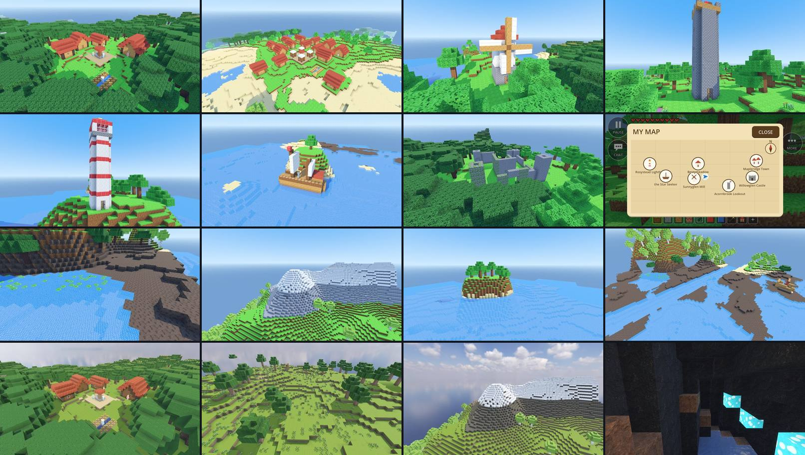

# Owner feedback #45b: a bigger world (notes)

Owner, 2026-09-24 21:49: "save into plan that we should continue implementing new quests and also we should extend the
world". Brief `docs/superpowers/briefs/prompt-own45.md`, section "45b — Extend the world"; spec **§14.18** (new); plan
M3 Task 24b. Built by a background agent in its own worktree (branch `worktree-agent-a4b05011a7fe365bc`, cut from
`m2-survive-the-night` at `b0c3f08`: everything merged the night of 2026-09-24), without the editor or the emulator.
Part a (quests, quest givers, the quest book) is another agent's; this part leaves hooks for it (below).

*Left to right, top to bottom (seed 12345, BLOCKY): Berrymeadow, a village in a dark forest's clearing (the plaza
and its well, houses, the wheat farm); Mapleridge Town on its beach; Sunnyglen Mill; Acornbrook Lookout; Rosystead
Lighthouse; the Star Seeker at its pier; Willowglen Castle's ruins; the world map with seven found places; a swamp's
pools with lily pads; a snowy mountain top; an island; a river's mouth (and a treasure pack shipwreck). Then
REALISTIC: Berrymeadow, a flower field, the snowy mountain, a glowing mushroom cave. Every view in both styles (32
JPEGs, 640 × 360) comes from `tools/world_shots.gd`.*

## What was built

| Piece | Where | What it does |
|---|---|---|
| Terrain versions | `WorldMeta.terrain` (+ `places_found`), `UniverseRegistry.shape_for/generator_for(u, seed, terrain)`, the meadows descriptor's `terrain_shape`, `terrain_generator`, `secret_rules`, `WorldService.terrain_version`, Session section "Owner 45b" (`world_terrain`, `_rpc_own45b_terrain`), two lines in `sandbox.gd` | Only edited chunks are saved, so a world keeps the terrain it was made with: 1 = the M1–M3 Green Meadows (every world saved before, forever), 2 = the wild meadows (every new world). A guest gets the host's version before `world_info`, like the universe; its secrets are worked out on that terrain (the meadows descriptor's `secret_rules`, which the sandbox already calls for every universe). |
| Block page 13 | `world/universes/meadows_blocks.gd` (`MeadowsBlocks`), `BlockIds` 256–271, `data/blocks/pages/meadows*.png`, `tools/make_meadows_page.gd`, `tools/make_meadows_realistic.py`; `BlockLibrary` page extras `cross` (two crossed pictures) and `height` (a lower cube) | birch wood/leaves, dark wood/leaves, flowers, lily pad, mud, stone bricks, mossy bricks, white plaster, roof tiles, hay, wheat, sail cloth, glow mushroom, dirt path — both styles (the realistic one from CC0 ambientCG materials, credited). The natural-block lists (bots, meteors, the axe, the wand), Survivor drops (leaves give nothing), `/give` know them. |
| The wild meadows' rules | `world/generators/meadows_biome_shape.gd` (`MeadowsBiomeShape`) | `column(x, z)` = (height, biome, flags): the old continents, hills and mountains with meadows, flower fields, birch forests, dark forests, swamps (mud, pools, lily pads), beaches, mountains (rock over 80, snow over 90), the sea, rivers and islands; trees by biome; cave regions; the spawn on friendly land; `chunk_columns` (a chunk column worked out once, cached). |
| The generator | `world/generators/meadows_biome_generator.gd` (`MeadowsBiomeGenerator`) | writes the columns in runs, the old caves and ores, the cave regions (a mushroom region's mud floors, glowing caps and giant mushrooms; a lake region's caves flooded below y −22), the biomes' trees (oak, a slim birch, a wide dark oak) from each chunk column's tree list, the places, the secrets. `reference_block` is its slow rule. |
| Places | `world/generators/meadows_places.gd` (`MeadowsPlaces`) | windmill, village (plaza, well, 3–6 houses, paths, a wheat farm, villagers), lookout tower (a spiral stair to a battlemented top and a flag), lighthouse (red and white, a stair to a glass lamp room with a glowing lamp), ship (hull, deck, two masts with sails, a cabin, a pier to the shore), castle ruins (broken walls of stone and mossy bricks, corner towers, a gate, a keep's stumps), town (a bigger village with two rings of houses and market stalls). |
| Finds and villagers | `world/places_director.gd` (`PlacesDirector`, node `Places`), `entities/npcs/villager.gd` (`Villager`, a `Trader`) | the host finds places near players (twice a second), saves them, tells every game; "You found Berrymeadow! It's on your map." on the finder's screen with the sparkle; villagers stand in villages (and the miller, the ship's sailor) near players, wave, and in Survivor open Tilly's shop. |
| The world map | `ui/map/world_map_panel.gd` (`WorldMapPanel`), `HudIcons` picture `map`, `ChatCommandRunner.point_at`, the sandbox's section "Owner 45b" | MORE → MAP: the places found in this world round the child's arrow and home, each with its picture and name; a tap sets the /find arrow and closes the map; only in worlds with places. |
| Gifts carry the new blocks | `BuildCodec.BLOCK_MAX` and the server's `BuildRules.BLOCK_MAX` 255 → 399, module **0.2.5** | builds (gifts, showcases, bottles) may hold ids up to 399 (items start at 400). |
| Tools | `tools/bench_generator.gd -- --biomes`, `tools/world_smoke.gd` (+ steps), `tools/world_shots.gd` (+ steps); the tour's scout and the secret and treasure smoke and shot tools use the world's own terrain now | |

### The biomes (seed 12345, 10 000 columns over 4.8 km)

sea 28.7 %, dark forest 15.7 %, meadow 14.7 %, birch forest 14.1 %, swamp 8.8 %, flower field 7.9 %, beach 4.0 %,
mountain 3.5 %, river 1.4 %, island 1.1 % (`test_meadows_biomes.gd` prints it). Trees per column: birch forest 0.049,
dark forest 0.061, meadow 0.015 (the old meadows' oaks, at the same spots).

### Rivers run to the sea

The old meadows' rivers are the zero lines of a noise: most of them are closed loops. Measured (a breadth-first walk
through water from a river cell to the open sea, 12 river cells each of four seeds): only 17 of 48 reached the sea
within about 1 km. The wild meadows' rivers are two families of long winding lines — family A where x + 120 ×
noise(x, z) is near a multiple of 1000, family B the same with z and 1300 — whose warp never turns faster than the line
runs (tested: the line value always grows), so a river never closes into a loop: it crosses the whole world, meets
every river of the other family and the sea. Every sampled river cell reached the open sea (29–250 steps of 4 blocks,
`test_rivers_reach_the_sea`); rivers widen from 7 to 19 blocks where they meet the coast.

### Places (seed 12345, 576 regions: about 6 km across)

301 places: 75 villages, 63 lookout towers, 52 windmills, 38 castle ruins, 33 lighthouses, 32 ships, 8 towns (windmills
only on open land: meadows, flower fields, birch forests, islands; villages and towns there or in a dark forest's
clearing; castles never in a swamp). Rare kinds (ship, castle, town): 4 of 21 places within 1,200 blocks of the spawn,
74 of 280 farther out; a region holds a place more often farther out (40 % by the spawn, 85 % from 2.5 km). The nearest
village of seed 12345 is Berrymeadow, 358 blocks from the spawn, in a dark forest's clearing (no tree grows within 4
blocks of a place: `MeadowsPlaces.in_clearing`).

## Skills and patterns (godot-prompter)

- **procedural-generation:** seeded randomness per region (a fixed draw order, the terrain checks after the draws),
  noise for biomes (FastNoiseLite: warmth, wetness, islands, river warps), placement checks against the terrain rules
  (not the voxels), reachability by construction (every door opens on a pad, every stair climbs one block a step; both
  tested). Rejected: BSP or wave-function-collapse villages (a fixed ring of houses round a plaza reads well to a child,
  is walkable by construction and costs a few height lookups), cellular-automata caves (the 3D noise caves exist; the
  new cave regions decorate and flood them instead of carving more — the carving is the underground's cost).
- **godot-ui / hud-system:** the map is one full-screen overlay (a dim backdrop, a paper card, big round picture
  badges with names under them, a CLOSE button), drawn in code (no textures); it takes new touches in `_input` like the
  MORE panel so the HUD's buttons never hear them; its button lives in MORE (no new always-visible button).
- **multiplayer-basics:** the host decides every find (authority RPC to every game, a guest asks for the list on
  arrival); villagers are local decoration made from the seed on every game (nothing to sync), the host's copies near
  every player make Tilly's reach check work for a guest's trade.
- **godot-optimization:** the generator's work per chunk column is done once for its stack of chunks (the column cache
  and the trees' lists), measured with the bench below; nothing new per frame (the director looks twice a second,
  villagers exist only near players).

## Tests (RED → GREEN)

| File | Tests | RED (why it failed first) |
|---|---|---|
| `tests/unit/test_meadows_blocks.gd` | 15 | page 13 not registered, its files missing, no crossed-picture or low models, birch and dark leaves dropping themselves |
| `tests/unit/test_meadows_biomes.gd` | 19 | missing `MeadowsBiomeShape`; then mountains 0.3 % of the land and 82 blocks at most, one swamp pool, a lily pad on the open sea (the flags were set before the biome) |
| `tests/unit/test_meadows_biome_generator.gd` | 9 | missing `MeadowsBiomeGenerator`; then the cost test at 1.02 × the old meadows (the column writer went to runs, the trees to per-column lists: 0.65–0.8 ×); the new clearing check found leaves in a village |
| `tests/unit/test_meadows_places.gd` | 12 | missing `MeadowsPlaces`; then a town's 14 villagers (the test's bound was too tight), 170 of 296 places windmills (a failed coast kind fell back to the first land kind: coast spots and a weighted fallback since) |
| `tests/integration/test_terrain_version.gd` | 5 | missing `WorldMeta.TERRAIN_LATEST`, `shape_for(…, terrain)`, `Session.world_terrain`; then `WorldService.terrain()` clashed with the new field (renamed `terrain_version`) |
| `tests/integration/test_places_director.gd` | 7 | missing `PlacesDirector`, `Villager`; then `Villager._body_parts` shadowing Trader's static (renamed), Tilly's unused hint arrow left as an orphan, the test's own first player standing next to the villager |
| `tests/integration/test_world_map.gd` | 7 | missing `WorldMapPanel` and the `map` picture |
| changed | | `test_block_library.gd` (flowers and wheat are mesh models), `test_build_codec.gd` (ids 256–399 travel); the server's `gift_rules`, `gifts_rpcs`, `wallet_host` and integration tests (module 0.2.5) |

Full suite (`tests/suite_slots.sh tests/run_tests.sh`, each on a snapshot of the staged commit): **4560/4560 (470
scripts)** for `91dfc79`, **4574/4574 (472 scripts, 2 pending)** for `60e2454`. That second commit's first run had one
failure, `test_visit_world.gd`'s "the island's grass stays" (a 20 s wait for M4 I's visit terrain, load 35); it passed
alone and on the rerun (nothing of this work touches the visit world).

74 new tests. Mutation checks (run): removing the clearing check fails `test_places_are_generated_without_seams` (leaves in a
village); removing the lily pad's biome check fails `test_the_sea_bed_is_sand_and_the_water_reaches_the_sea_level`;
the column cache off (`columns_cached = false`) keeps every block (`test_the_column_cache_changes_nothing`).

## The generator's cost (the brief: at or under Green Meadows' per chunk)

`godot --headless --path . --script res://tools/bench_generator.gd -- --biomes` (new mode, `_bench_biomes`): 2,016
chunks (12 × 12 chunk columns, y −64 … 159, a whole stack per column the way a world streams them), the three generators
alternating chunk by chunk, the secret areas placed before the clock starts (as the other modes do), the column cache
empty at the start (each column's heights, biomes and trees are paid once per stack, as in the game).

**Before** (the old meadows' own bench, `bench_generator.gd`, at `b0c3f08`, before any change; the old generator is not
touched by this work): surface 1.93 ms, underground 1.13, sky 0.76 a chunk at load 5 (2.76 / 1.58 / 1.02 at load 31).

**After** (`-- --biomes`, the final code, same chunks, alternating):

| chunks | old meadows ms | wild meadows ms | wild, no column cache ms |
|---|---|---|---|
| surface (y 0 … 79, 720) | 2.35 | **2.15** | 3.99 |
| underground (576) | 1.82 | **1.68** | 2.09 |
| sky (y 80+, 720) | 0.93 | **0.05** | 1.74 |
| all (2,016) | 1.69 | **1.26** | 2.64 |

(load 18; earlier runs of the final code: surface 2.22 → 2.09, underground 1.75 → 1.62, sky 0.87 → 0.05, all 1.60 → 1.23 at
load 29–33; all 2.11 → 1.64 at load 38.) Worst chunk: 28 ms for the wild meadows against 18 for the old (the first chunk
of a region pays for its places and the secrets of their areas, once, on a generator thread). A new region's places:
**2.2 ms** on average, worst 9.8 (`BENCH_BIOMES_PLACE_REGIONS`, 64 regions, 19 places); a secret area on the wild
terrain: 0.87 ms (the treasure pack's lookups use the wild shape's one-call columns).

How it got there: the first version cost 3.94 against 3.04 on the surface (+30 %). Three changes paid for the biomes:
the chunk column's heights, biomes and trees worked out once for its whole stack (`chunk_columns`, 2,048 columns cached)
instead of once per chunk; the column writer in runs (four `fill_area`s instead of a function call per block); the
trees from each chunk column's list (nine lookups a chunk instead of rolling 484 candidates), written with precomputed
crowns clipped to the chunk and one `fill_area` per trunk. The sky chunks, which the old meadows spent 1 ms on (256
heights for nothing), now cost almost nothing.

`test_a_chunk_costs_no_more_than_the_old_meadows` checks the same bar on 108 chunks in the suite (the best of three
rounds ≤ 1.0: 0.65–0.95 in the runs). The emulator's autopilot flight over the new biomes, in both styles, is the lead's
check (below).

## Smoke run on real terrain

`XDG_DATA_HOME=<private "smoke" dir> godot --headless --path . --script res://tools/world_smoke.gd` (new Sandbox world,
seed 12345): **24 checks, 0 fails** — terrain 2 (and Session would tell guests 2), the places director on, MAP in MORE;
Berrymeadow, the nearest village (358 blocks from the spawn), streamed in 2.0 s with its well (stone bricks round
water), its plaza of dirt path and an open house door; found by walking in ("You found Berrymeadow! It's on your
map."), its 6 villagers there (no trade in the Sandbox); MAP opens the map with the village and nothing else, a tap
sets the find arrow to it and closes the map; the save keeps the find; Rosystead Lighthouse's lamp lit at the top and
its stair from the first step to the last, found too; birches in a birch forest and snow on a mountain top in the real
chunks. No engine errors.

## Rulings (decisions on the owner's behalf; cost if wrong)

1. **A terrain version, new worlds only.** Only edited chunks are saved (`VoxelStreamSQLite` keeps no generator output),
   so any change to the Green Meadows generator would change the untouched land of every saved world, and its edited
   chunks would meet new land at a seam. `WorldMeta.terrain` 1 stays the old meadows forever; new worlds get 2.
   *Cost:* children see the wild meadows only in a new world. A later version could blend them in beyond the explored
   land of old worlds.
2. **Block page 13, ids 256–271.** Every 16-id page up to 255 was taken (the Dragon Realm took page 11 tonight), and
   items own only 100–175 and 400+; the voxel type channel is 16-bit and the edit log keeps 16 bits, so blocks may use
   256–399. `BuildCodec.BLOCK_MAX` and the server's `BuildRules.BLOCK_MAX` rise to 399 together (module 0.2.5).
   *Cost:* until the live server runs module 0.2.5, a gift or showcase holding one of the new blocks is refused by the
   server (the lead's deploy step below).
3. **Not in the Sandbox palette's BLOCKS grid** (it keeps its size: SmartPage's ruling). They come with the land
   (breaking them in Survivor, like the desert's) and `/give` in the Sandbox. *Cost:* a Sandbox child can't pick
   stone bricks from the palette; a palette row (the SMART tab's third row?) is a small follow-up.
4. **Rivers are two families of warped lines** (above), about one every kilometre each way. *Cost:* the network is a
   little regular from the air (a warped grid); the old meadows' loops are gone in new worlds.
5. **Taller mountains**: the mountain noise rises from 0.18 (a quarter of the land) with 82 × m^1.6 (the old: 70 × m²),
   heights over 100 rise half as fast (under 120, the streaming box's top); rock over 80, snow over 90. *Cost:* a few
   more cliffs on mountain flanks.
6. **Swamps** flatten the land to the sea level where it is wet (never on mountains); pools where the detail noise dips
   (about a quarter), 18 % of them with a lily pad. **Islands** rise from the sea where an island noise is high, sand
   round them (beaches reach 2 over the sea by the coast). *Cost:* none known.
7. **Cave regions** (128 × 128, 18 % mushroom caves, 15 % lake caves) only change what the old caves already carve
   below y −20 (the crystals' depth): a mushroom region's floors are mud (7 % glowing caps), its ceilings glow now and
   then (no crystals), and giant mushrooms (a white plaster stem, a 3 × 3 glowing cap) grow where one fits whole inside
   its chunk (so no chunk ever cuts one in half); a lake region's caves are water below y −22 (the old flood line is
   −40). *Cost:* the giant mushrooms' stems are plaster (no stem block of their own: the page is full).
8. **One place per 256 × 256 region at most**, rarer farther away (windmills from 60 blocks, villages 150, towers and
   lighthouses 250, ships 400, castles 700, towns 1,200; a region's chance 40 % → 85 % at 2.5 km), a lighthouse or a ship
   only in a region with a coast (found on a 16-block grid of the region). *Cost:* about one place every 300 blocks;
   denser if the owner wants.
9. **A place gives way to the secrets** (4 blocks of room in all three directions from every secret's boxes, the
   treasure pack's included): the secrets and their saved ids never move for a place. **60 blocks round the spawn stay
   clear** like the treasure pack's (the quest givers of §14.17 stand 13–19 blocks out). *Cost:* a place is skipped
   where a secret sits.
10. **Where places stand:** windmills on open land (meadows, flower fields, birch forests, islands), villages and towns
    there or in a dark forest (a village clears its ground of trees: nothing grows within 4 blocks of any place),
    castles anywhere but a swamp, lighthouses and ships on a coast, towers anywhere (the highest of their tries).
    *Cost:* fewer villages in swamps and on mountains.
11. **Villages never cut into water or cliffs:** every house, the plaza and the farm stand on a pad whose ground rises
    and falls at most 3 blocks (sampled every 2 blocks and at its edges), dry and off the rivers; paths follow the ground
    as it lies. A village needs 3 houses (a town 6), else another kind or none. *Cost:* fewer villages on hilly land.
12. **Found by the whole world:** a place anyone finds is on everyone's map in that world (saved by the host in
    `WorldMeta.places_found`). *Cost:* in co-op a child sees places a friend found (the map is the team's).
13. **Villagers**: no collision (one stands at every other house's door and never blocks it; a tap finds them like Tilly),
    local on every game (made from the seed near players, nothing synced), Tilly's shop in Survivor (her stock and prices:
    "trade with Tilly's rules"), a wave and a name in the Sandbox. The windmill's miller and the ship's sailor are
    villagers too. *Cost:* the shop panel says Tilly's things; a villager has no shop of its own.
14. **The world map shows only what the world found** (and other tasks' marks), north up, round the child: nearer places
    spread out more than far ones (the distance's square root), badges push apart so names never cover each other; the
    child's arrow and home. MAP is in MORE only in worlds with places (not in old worlds, other universes or the arena),
    or once another task marks a place. *Cost:* a child in an old world has no map; distances on the map are not to
    scale.
15. **The director shares the generator's places** (`MeadowsBiomeGenerator.places`: worked out on the generator's
    threads for the terrain round the players, so a find costs no new work on the main thread). *Cost:* none.
16. **The treasure pack's fast column path** also serves the wild meadows (one column call per lookup instead of two).
    *Cost:* none (the same answers).
17. **No new progress counter** here (45a is adding board goals): `PlacesDirector.place_found(place, peer)` is the hook.

## Hooks for the quests (§14.17, 45a)

- `sandbox.places_director.places` (`MeadowsPlaces`): `nearest(pos, kind, rings)`, `places_near(pos, radius)`,
  `find(id)`; `MeadowsPlaces.village_centre(place)` (the middle of a village's plaza, by the well: where a quest giver
  could stand); every place has `name` ("Berrymeadow", "Rosystead Lighthouse", "the Sea Otter").
- `places_director.place_found(place, peer_id)` (host) when a player finds a place.
- `places_director.mark({id, kind, name, pos})` puts another task's place on the world map (a chain's "new place on
  the map"); `found_places()` is what the map shows.

## Merge notes for the lead

- `BlockIds.COUNT` is 272 (other branches raise it too: take the largest). The Dragon Realm (page 11) and Task 8 (page
  12) don't touch 256–271.
- Spec §14.18 sits after §14.17 (45a's quests).
- The server module is 0.2.5 (only `BLOCK_MAX`): build it and deploy it to the live server (`kit.sh pack` → the VPS →
  `./kit.sh update`) before children gift builds with the new blocks; `npm --prefix server/modules test` 231/231.
- Shared files touched (small, marked "owner #45b"): `block_ids.gd`, `block_library.gd`, `world_meta.gd`,
  `world_service.gd`, `universe_registry.gd`, `meadows.gd`, `session.gd` (own section at the end + one line in
  `_rpc_hello`), `sandbox.gd` (own section at the end + five lines), `chat_command_runner.gd` (`point_at`),
  `hud_icons.gd` (`map`), `gather_rules.gd`, `bot_rules.gd`, `surprise_rules.gd`, `tool_powers.gd`, `capture_rules.gd`,
  `build_codec.gd`, `treasure_places.gd` (one condition), `tools/tour*.gd`, the secret and treasure smoke and shot steps.

## Emulator checklist (for the lead)

1. **Start a NEW Sandbox world** (only new worlds get the wild meadows) in BLOCKY: birch and dark forests, flowers,
   swamp pools with lily pads, a river running to the sea, an island, a snowy mountain top; then REALISTIC: the same.
2. The nearest village (godot-mcp exec: `sandbox.places_director.places.nearest(player.global_position, &"village", 8)`):
   walk into its plaza — "You found …! It's on your map." and the sparkle; the villagers turn and wave; a house's door;
   the farm's wheat.
3. **Survivor**, a new world: tap a villager → Tilly's shop; buy something.
4. MORE → MAP: the found places with their pictures and names; tap one → the find arrow points there, the map closes.
5. A lighthouse or a lookout tower: climb the stair to the top (auto-step), the view.
6. A mushroom cave and an underground lake (y −20 … −40 in their regions).
7. **The autopilot's 2 km flight over the new biomes in both styles** (a new Sandbox world first, then AUTOPILOT BLOCKY
   and AUTOPILOT REALISTIC): ≥ 30 FPS, no frame over 100 ms.
8. An **old saved world** looks exactly as before and has no MAP button.
9. LAN or online: a guest joining a new world sees the same land, places and villagers; a guest's find shows on the
   host's map too.
