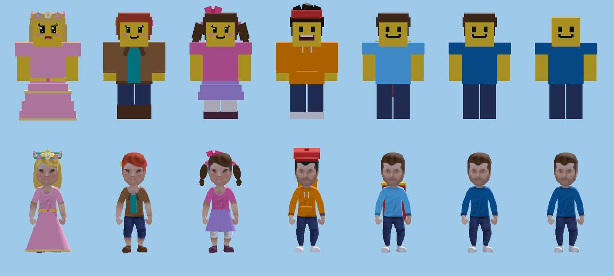
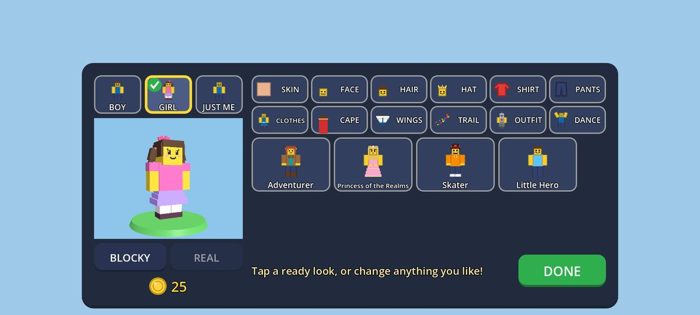
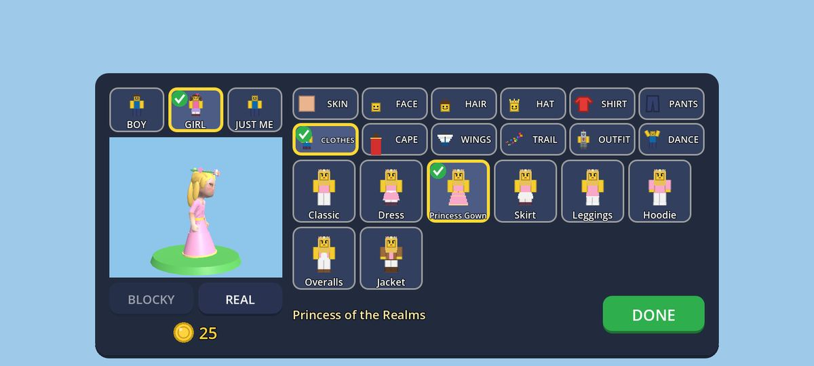

# Owner feedback #48: girl avatars (2026-09-25)

The owner (2026-09-24 22:53): "when choosing avatar there should be avatar of girls as well", "beautifull
girl". Brief `docs/superpowers/briefs/prompt-own48.md`; spec §14.6a (new), plan M3 Task 25. Built in a
worktree from `lead-merge` at `27306da` (the #35 shop and pets included; brought up to `lead-merge` `6c838c6`,
#49 and #50 and the pets' voices, before the final suite), without the editor or the emulator.
The lead checks it on the emulator: see the list at the end.

*Front: Princess of the Realms, Adventurer, the GIRL start, Skater, Little Hero, the BOY start, JUST ME
(blocky over realistic). More in `owner-48/` (a `.gdignore` folder, like owner-49's), all made by
`tools/girl_avatar_shots.gd`: the same from the back (`owner-48-looks-back.jpg`), every hair style front and
back (`owner-48-hair.jpg`, `owner-48-hair-back.jpg`: long bangs, ponytail, pigtails, braid, two buns, curly
bob, long, bun, curly), every clothes cut (`owner-48-clothes.jpg`), the faces close up (`owner-48-faces.jpg`:
Sweet, Lovely, Rosy, Smile), the editor after GIRL (`owner-48-editor.jpg`) and the princess in REAL on the
CLOTHES tab (`owner-48-editor-real.jpg`), the first-launch step (`owner-48-first-launch.jpg`).*

## What was built

| Part | Where |
|---|---|
| **The first choice** BOY / GIRL / JUST ME: `AvatarLook.base` (`boy`, `girl`, `neutral`; old profiles and bad values are neutral). `AvatarLook.start(base, keep)` puts on the starting look (`AvatarCatalog.STARTS`) and keeps the child's skin tone and dance wheel. It stays on this phone: `to_code()` (the synced look) and `ProfileBackup.to_backup` leave it out. | `core/avatar/avatar_look.gd`, `avatar_catalog.gd`, `core/save/profile_backup.gd` |
| **In the editor**: three picture tiles over the preview (drawn in the child's skin tone). A new choice puts on its start; any choice opens the **LOOKS** view: the four ready looks as big pictures, the chosen side's first; one tap wears one (`pick_preset`), with "Tap a ready look, or change anything you like!". Every tab still mixes anything. The preview is 340 × 276 (was 372 tall) so the whole panel fits 720 px with a margin. | `ui/avatar/avatar_editor.gd` (section "Owner 48" at the end + the tab tables), `avatar_tile.gd` (`look`, `caption_size`), `avatar_icon.gd` (`BASE`, `PRESET`, clothes pictures, shoes and long sleeves on the little figure) |
| **The first-launch step**: after the name, "Pick your look" with three 250 px pictures; a tap saves the start and goes to the main screen. | `ui/avatar/look_choice.gd` (`LookChoice`), `ui/menus/menu.gd` (`_show_look_step`) |
| **Girl parts, all FREE** (`AvatarCatalog.GIRL_PARTS`, 19 ids): hair Long Bangs, Ponytail, Pigtails, Braid, Two Buns, Curly Bob (with the old Long, Bun, Curly); hair colours purple and platinum (pink and blond were there); hats Hair Clips, Flower Crown, Hair Bow; faces Sweet and Lovely (cartoon lashes, rosy cheeks, a sweet smile) and Rosy (cheeks only); clothes colours lilac, mint, rose. | `core/avatar/avatar_catalog.gd` |
| **The CLOTHES tab** (12 tabs now, two rows of six): Classic (tee and pants), Dress, Princess Gown, Skirt, Leggings (a tunic over them), Hoodie, Overalls, Jacket (with boots). A cut is worn in the child's own shirt and pants colours (`AvatarCatalog.CUTS`; `resolve()` gives `top`, `bottom`, `sleeves`, `puff`, `boots`); an outfit still wins over it. | `avatar_catalog.gd`, `avatar_look.gd` (`resolve_in`) |
| **Blocky parts**: box hair on a soft cap with full bangs (`hair_girl`), box faces, hats and clothes (stepped A-line skirts, a tiered gown with a gold hem, sash, hood, pocket, bib and straps, an open jacket over the tee). The body's own sleeve and shoe boxes change size: long sleeves, puffed sleeves, boots. | `entities/player/avatar_parts.gd`, `blocky_avatar.gd` |
| **Realistic parts**: round shapes (new `BALL`, `CONE`, `TUBE` in the part builder, still one merged mesh per part) over the painted hair: a long back panel, ponytail, pigtails, braid, bun, buns, curly bob; real skirts (frustums) on a new WAIST anchor (the Hips bone), front pieces on a new chest BODY anchor. A part "`<id>_real`" replaces "`<id>`" on the realistic person. Girl hair and faces with lashes wear the long-haired, smooth-faced Kenney skin. | `avatar_parts.gd`, `avatar_model.gd` (`_part_id`, `waist_anchor`, `_resolved`), `realistic_avatar.gd`, `avatar_skin.gd` |
| **The realistic face**: `avatar_skin.gdshader` paints cartoon lashes (the upper lid and two flicks) and rosy cheeks at the painted face's eyes and cheeks (`AvatarSkin.FACE_SPOTS`, per texture), only for faces that have them; one material per look as before. | `avatar_skin.gdshader`, `avatar_skin.gd` |
| **Bot friends**: every `BotRules.LOOKS` entry has an `avatar` (free parts) worn in the bot's own colours; three are girls (the long-haired realistic body). New friends come girl, boy, girl… (`PICK_ORDER`). | `core/rules/bot_rules.gd`, `entities/bots/bot_blocky_avatar.gd`, `bot_realistic_avatar.gd` |
| **Pictures without the emulator**: `tools/girl_avatar_shots.gd` (see DEVELOPMENT.md). | `tools/girl_avatar_shots.gd`, `_steps.gd` |

Child-appropriate by construction: no part changes the body's shape (sleeves, puffs and boots are clothes
boxes; the skirts sit over the unchanged legs), the only face additions are cartoon lashes and pink cheeks
(a test holds `FACE_STYLES` to those two keys), the clothes are school-and-party clothes with tights or
leggings under every skirt, and the gown reaches the ankles.

## Patterns (GodotPrompter `shader-basics`, `godot-ui`)

- **Chosen:** one shared recolour shader with new uniforms (lashes, cheeks as signed-distance strokes and
  soft circles in UV), so the realistic face needs no new textures and the material cache still keys one
  material per look; containers built in code like every menu (`HBoxContainer` of `AvatarTile`s), the same
  tile pictures reused for the first-launch step; mesh arrays from `SphereMesh` / `CylinderMesh`
  (`get_mesh_arrays`, 12 × 6 and 16 sides) merged into the existing one-mesh-per-part builder, with normals
  divided by the stretch so long balls shade round.
- **Rejected:** new painted Kenney textures (per-look image work, CC0 bookkeeping, more VRAM), decals on
  the face (a draw call each and a second shader), a `TabContainer` for the choice (M2 Task 6's gotcha), a
  13th tab (a third tab row would not fit 720 px), putting the choice above the tabs (the panel was 612 px
  tall: over the screen), CSG or `MeshInstance3D` per shape (draw calls on phones).

## Tests (RED → GREEN)

New: `tests/unit/test_girl_avatars.gd` (15), `tests/integration/test_girl_avatar_models.gd` (11),
`tests/integration/test_avatar_start_choice.gd` (9); `test_shop_catalog.gd` gains
`test_no_girl_or_boy_part_is_ever_sold`, `test_shop_child_side.gd`'s no-WISH scan covers every girl part.

- **Rules:** `test_girl_avatars` was run before any code: it failed to parse for the right reasons
  (`Cannot find member "CLOTHES"`, `"GIRL_PARTS"`, `"CUTS"`, `"FACE_STYLES"`, `"BASES"`, `Static function
  "start()" not found`, no `lilac`/`mint` colours). GREEN (15/15) after the catalog, the look and the bot rules.
- **Both bodies:** `test_girl_avatar_models` ran RED with 10 of 11 failing ("Expected [<null>]: blocky
  bangs", "realistic ponytail", "humanMaleA.png expected to equal humanFemaleA.png: bangs wears the
  long-haired, smooth-faced skin", "Nonexistent 'float' constructor" for the missing shader uniforms). GREEN
  after the parts, anchors and shader. A real fault on the way: a bot applying its look before `_ready`
  called the blocky `_color_body` before its boxes existed ("Invalid access to property or key 'Head'"):
  bots now set the look for `_ready` to dress.
- **Editor and first launch:** `test_avatar_start_choice` failed to parse first (`Cannot find member
  "LOOKS" in base "AvatarEditor"`, `Could not find type "LookChoice"`), then passed. Tightening its fit
  check from the editor to the **whole panel** (with an 8 px margin) turned it RED again: the panel was
  612 px tall on a 720 px canvas with the choice row above the tabs. Moving the choice over the preview
  (and the preview to 276 px) made it 561 px: GREEN.
- **Nothing sold (mutation check):** with the Flower Crown made a 100-gold item and the Princess Gown put in
  the Sky Pack, 5 tests failed ("hat.flower_crown is free", "pack_sky lists clothes.gown", "the princess
  look is free parts only", "clothes.gown: no WISH", "hat.flower_crown: no BUY"); GREEN with the catalog back.
- Old tests all pass unchanged: `test_avatar_look`, `test_avatar_unlocks` (the jacket was renamed from
  "Adventure Jacket" to "Jacket": names must fit under an icon), `test_avatar_looks`, `test_avatar_editor`,
  `test_avatar_menus`, `test_bot_friends`, `test_bot_rules`, `test_look_sync`, the shop tests.
- **Full suite** (through `tests/suite_slots.sh tests/run_tests.sh`): on the `27306da` base 4536/4538, the two
  failures being the pets' missing voices that `lead-merge` had already fixed (`cfd9a51`); after merging
  `lead-merge` `6c838c6`: **471 scripts, 4563/4563 passing, exit 0**, no `SCRIPT ERROR` / `Parse Error`, 738 s.

## Rulings (decisions made on the owner's behalf; each is one table line or constant)

1. **A CLOTHES tab, not dresses as outfits or pants.** The brief suggested OUTFIT/PANTS parts; outfits have
   fixed colours and replace the headgear, so a dress there couldn't be pink *or* mint and couldn't wear the
   flower crown. A cut worn in the child's own shirt and pants colours can. Outfits still win over a cut.
   *Cost if wrong:* the owner may want costume dresses too; one `OUTFITS` line each.
2. **The choice keeps the skin tone and the dance wheel and replaces the rest** (hair, face, hat, clothes,
   colours, cape, outfit); tapping the chosen one again only shows the ready looks. *Cost if wrong:* a child
   who dressed up and then taps GIRL loses the cape they picked (bought items stay owned: re-pick in a tap).
3. **The choice stays on this phone** (not in the synced look or the server backup): a gender record is
   personal data for Families/Data safety, and other players only need the parts. *Cost if wrong:* after a
   restore on a new phone the editor shows JUST ME highlighted; the look itself is restored exactly.
4. **Everything for girls and boys is FREE and COMMON**: never gold, never a pack, never on the wish list,
   never "rare". The presets use free parts only. *Cost if wrong:* none (the owner's rule and #35's).
5. **Starting looks**: BOY = short brown hair, the classic clothes; GIRL = brown pigtails, a hair bow, the
   Sweet face, a pink tee and a lilac skirt over tights; JUST ME = today's classic look. *Cost if wrong:*
   one `STARTS` line each.
6. **Ready looks**: Adventurer (red ponytail, clips, teal tee under a jacket, jeans, boots), Princess of the
   Realms (blond long bangs, flower crown, rose gown), Skater (spiky black hair, cap, orange hoodie), Little
   Hero (short brown hair, sky tee, hero cape). *Cost if wrong:* `PRESETS`.
7. **Skirts come with tights** (light tights under a skirt; a dress or gown over tights in the pants colour;
   leggings under a tunic). No bare legs under a skirt. *Cost if wrong:* none known.
8. **The realistic person gets round shapes, not its own textures**: box hair would look wrong on the smooth
   Kenney head (Task 9's ruling 9), and there are only two Kenney skins. The girl hair styles, and any face
   with lashes, wear the long-haired, smooth-faced skin (the other has stubble). *Cost if wrong:* realistic
   ponytails are ellipsoids, not modelled hair; a modeller's hair meshes can replace the `_real` recipes.
9. **The realistic face's lashes and cheeks are painted by the shader** at measured texel spots
   (`FACE_SPOTS`); the painted mouth stays (a "sweet smile" shows on the blocky face only). *Cost if wrong:*
   lashes look thin at phone size; they can be made thicker in `lash()`.
10. **Bots**: three of six looks are girls, and new friends come girl first, then boy (never an all-boy team
    of one). Realistic bots keep their dyed skins, so their hair add-ons are dark brown/black like the
    painted hair. *Cost if wrong:* `PICK_ORDER` and `LOOKS[i].avatar`.
11. **Hair colours**: pink and blond existed; purple and a light **platinum** blonde were added for "pink,
    purple and blonde". *Cost if wrong:* one colour line.
12. **The showcase** (M4 Wave 3's visit world) shows a friend's build, not their avatar, so there was nothing
    to change there; remote players and bots show the look through the synced code and their own looks.
    *Cost if wrong:* if the showcase gets an avatar later, it wears `AvatarLook.from_code` like players.

## For the lead

**Merge notes.** Shared files, each a marked section or a few lines: `core/avatar/avatar_catalog.gd`
(`CLOTHES` in `SLOTS`, 3 colours, 19 items at the end of `ITEMS`, the "Owner 48" tables after `OUTFITS`),
`avatar_look.gd` (`clothes`, `base`, `start`, `preset`, `resolve_in`), `avatar_unlocks.gd` (one default),
`entities/player/avatar_parts.gd` (shapes, 2 colour keys, recipes at the end of `PARTS`), `avatar_model.gd`
(`_part_id`, `waist_anchor`, `_resolved`), `blocky_avatar.gd` (sleeves and shoes in `_color_body`),
`realistic_avatar.gd` (two anchors), `avatar_skin.gd` / `.gdshader`, `ui/avatar/avatar_editor.gd` (the tab
tables, the choice over the preview, a section at the end), `avatar_tile.gd`, `avatar_icon.gd`,
`ui/menus/menu.gd` (the name's OK goes to `_show_look_step`), `core/rules/bot_rules.gd` (`LOOKS[i].avatar`,
`PICK_ORDER`), `core/save/profile_backup.gd` (two lines). Agents adding avatar items (#36 costumes) append to
the same tables: keep both sides. Anyone adding a slot to `AvatarCatalog.SLOTS` must add a tab word and
picture in `AvatarEditor.TAB_WORDS` / `TAB_PICTURES` (13 tabs would need a third row).

**Check on the emulator:**
1. A new profile (clear the app's data): after the name, "Pick your look" with BOY / GIRL / JUST ME fits the
   screen; GIRL goes to the main screen and the player in a world has pigtails, a bow and a lilac skirt.
2. Main menu → AVATAR: the three choices over the preview; GIRL shows Adventurer and Princess of the Realms
   first; one tap dresses the preview; the panel fits (20:9 and 16:9) with DONE fully visible.
3. REAL: the princess's gown, flower crown and long hair; the adventurer's ponytail and jacket; the pigtails
   swing with the head; skirts follow the hips when running (the legs may show through the front of a short
   skirt mid-stride: expected); the lashes and cheeks read at phone size (Compatibility renderer: the
   `force_srgb` path).
4. CLOTHES: every cut in BLOCKY and REAL; the hoodie's and jacket's long sleeves swing with the arms; boots.
5. Bot friends: the first friend is a girl (ponytail and skirt), the second a boy; in REAL their hair shapes
   sit on the painted hair.
6. LAN (two instances): the other player's girl look shows in each game's style; the synced code has no
   `base`.
7. Performance: the autopilot in REAL with the princess look (a gown and hair balls add ~1.2k triangles):
   no frame over 100 ms the first time a realistic girl appears (same shader, one more material per look).
