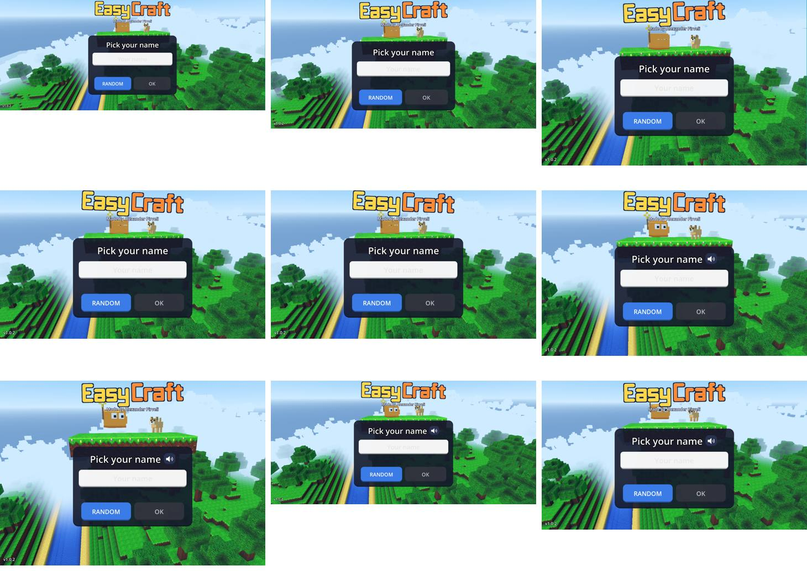

# The browser version and the Android app: what is the same, what differs (M7)

The owner's goal (2026-09-27): "build universal style app for any device using browser, it should be almost exactly
same, just without stores". This page shows it: the devices the browser version was run on, and every place where it
behaves differently from the Android app, with the reason. The spec for the browser version is §20; the numbers and
rulings are in `docs/devlog/2026-09-27-m7-web.md`.

Live: https://178-104-20-64.sslip.io/play/ (GitHub Pages sends iPhones and iPads there too).

## One game, one code base
The browser version is **the same Godot project, the same branch, the same scripts and scenes** as the Android app,
exported a third way (the "Web" preset). Every difference below sits behind one function in
`core/platform/platform_rules.gd`, has a test in `tests/unit/test_platform_rules.gd`, and changes nothing on Android.
All the game's content plays in the browser: the Sandbox, Survival, the realms, the buddies, Size Magic, stamps,
Mirror, building, farming, pets, the School with Professor Hoot (#68), space and the planets (#55), online play with
friends and chat (same server, same account, same gold), the Secret Book, photos, both graphics styles
(SIMPLE/CLASSIC controls and BLOCKY/REALISTIC pictures, changeable any time, #66).

## The device run (2026-09-29, the live build of 01:33)
`tools/web_device_matrix.mjs` opens the live page in each browser and device profile (Playwright: Chromium, Firefox and
WebKit, the engine of Safari and of every iPhone browser), waits for the page's PLAY, presses it with a real touch on
touch devices, waits for the game's menu, presses the game's PLAY and takes a picture. Headless browsers draw with the
CPU, so the times are slow and show only that each step comes; the emulator and phone numbers are in the dev log.

| Device (profile) | Browser engine | Page size (CSS px) | Page ready (s) | Menu after PLAY (s) | Threads | Page errors |
|---|---|---|---|---|---|---|
| Windows / Linux PC | Chromium | 1366×768 | 8.0 | 5.0 | on | 0 |
| Windows / Linux PC | Firefox | 1366×768 | 14.8 | 7.0 | on | 0 |
| Mac | WebKit (Safari) | 1440×900 | 5.6 | 7.0 | on | 0 |
| Android phone (Pixel 7) | Chromium | 863×360 (the page, Chrome's bars shown) | 15.9 | 5.0 | on | 0 |
| Android small phone (Galaxy S8) | Chromium | 740×360 | 10.1 | 5.0 | on | 0 |
| Android tablet (Galaxy Tab S4) | Chromium | 1138×712 | 6.7 | 5.0 | on | 0 |
| iPhone 15 | WebKit (Safari) | 734×343 (the page, Safari's bars shown) | 15.8 | 8.0 | on | 0 |
| iPhone SE | WebKit (Safari) | 568×320 | 14.3 | 7.0 | on | 0 |
| iPad Pro 11 | WebKit (Safari) | 1194×834 | 10.6 | 8.0 | on | 0 |

Each device ended on the game's first screen, "Pick your name" (no age question: #69), laid out for its screen:



(Rows of the picture: Android phone, small phone, tablet; PC Chrome, PC Firefox, Mac Safari; iPad, iPhone, iPhone SE.
The speaker button beside the title shows where the browser has a speech voice: read-aloud uses it.)

Run it again after a deploy:
```bash
PW_HOME=~/src/pwenv nice node tools/web_device_matrix.mjs https://178-104-20-64.sslip.io/play/ <out-folder>
```
Setup: Playwright in `~/src/pwenv` with `npx playwright install chromium webkit firefox`. It runs one device at a time
(the PC is shared) and takes about 4 minutes.

The real-device checks are on the Android emulator's Chrome (Pixel 8, API 35: install, full screen, typing, refresh
without a new download, saves after refresh, the freeze measurements) and on the owner's iPhone (the owner's list in
`docs/playtests/owner-feedback.md`: #59 typing, #62 the GitHub link, #65 Samsung Internet).

## What differs, and why
| Thing | The Android app | The browser version | Why |
|---|---|---|---|
| Getting it | Google Play | Open the link; one button installs it (Android and desktop Chrome/Edge: the browser's own install prompt; Samsung Internet: opens Chrome to install, #65; iPhone/iPad: a short Add to Home Screen guide, repeated now and then, because Apple allows no install button) | No store (the owner's goal). Apple lets only the player add a page to the Home Screen |
| Full screen | Always | Installed: always, like an app. In a browser tab: the page asks for full screen on PLAY; on an iPhone a tab can't hide Safari's bars, so the Home Screen reminder comes | iPhone browsers have no full-screen mode for pages |
| First start | Everything is in the APK | A small first download (code about 2.8 MB and media, brotli), the music and the REALISTIC pictures come while the child plays and are kept | The owner: "first download small, then continues in background" |
| Updates | A new APK from the store | The next visit downloads only what changed; a refresh downloads nothing | The owner: "after refresh i dont need to redownload the data" |
| Saves | The phone's app storage | The browser's storage for this site, asked to be kept; the online account keeps the profile too (#67) | A browser has no app folder. Clearing the site's data in the browser removes the local copy; the online account brings the profile back |
| Home Wi-Fi play (LAN) | Available | Hidden (never a dead button); online play with friends works | Browsers can't open that kind of connection |
| QUIT button | On the menu | Hidden | A tab or installed web app is closed the browser's way |
| Photos | Into the phone's gallery, with a share sheet | Saved as a download | A page can't write into the gallery |
| Vibration | Yes | Android browsers yes; iPhone browsers no | Safari has no vibration for pages |
| Farm reminders ("your crops are ready") | A phone notification | None | A page can't schedule a notification while it is closed; it would need web push and a permission request, not built |
| Graphics on the first start | The phone's default | LOW on phones and tablets (a player can raise it) | A browser draws with WebGL, slower than the app's Vulkan |
| Screen notch | The HUD keeps clear of it | The page keeps the game inside the safe area | The browser does it for the page |
| Big packs on iPhone/iPad | — | The REALISTIC pictures wait until a player picks REALISTIC | Safari reloads a tab that uses too much memory |
| Shop | Off | Off | The same: off everywhere until the owner turns it on |
| Shorts Theater | "Coming soon" (the channel list is still the sample) | "Coming soon" | The same today; when the real list comes, a browser needs its own video player (the app's is an Android web view) |
| Game controllers (owner #90) | A PlayStation or Xbox pad plays the whole game | The same, once the browser shows the pad (after its first button press; that press also presses the loading page's PLAY) | Browsers hide a pad until it is used (privacy) |
| A browser that cannot run it (owner #90) | — | A kind page: "This browser can't run EasyCraft yet…" (no WebGL 2 or WebAssembly: a PlayStation's, an old TV's) | A 3D game needs WebGL 2 |

Nothing else differs: menus, controls, worlds, rules, the server and the account are the same.
